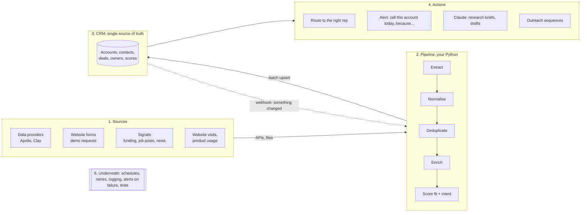

# 4. The whole system at a glance

Every concept in this repo is one box in this picture. Learn the picture first; then each folder is
a closer look at one box. In interviews, when asked "what would you build?" or "walk me through your
take-home", draw this from memory.

## Reading it left to right

1. **Sources** produce raw data about companies and people: data providers, website forms, news and
   job posts (signals), website visits. Your code reads them through **APIs** or **files**.
2. **The pipeline** is your Python code: it extracts raw data, **normalises** fields,
   **deduplicates** records, **enriches** gaps, and **scores** each company on fit and intent.
3. **The CRM** stores the clean result: accounts, contacts, deals, owners and scores. It's the one
   place everyone trusts. Your code writes to it with **upserts**, never blind creates.
4. **Actions** turn data into rep time saved: **routing** new leads to the right rep, **alerts**
   saying who to call today and why, **Claude** briefs and drafts, outreach sequences.
5. **The webhook loop:** when something changes in the CRM (a demo request, a stage change), the
   CRM calls your code instantly so the pipeline reacts in seconds.
6. **Underneath everything:** scheduled runs, retries with backoff for rate limits, logging, alerts
   on failure and tests. This is what makes it a *system*, not a *script*.

## One concrete example, end to end

> PeopleCo GmbH (Berlin, 120 staff, software) raised a Series A yesterday and posted a job for an
> "ISO 27001 Compliance Manager".

1. **Sources:** the funding news API and a job-post scraper both mention PeopleCo.
2. **Pipeline:** both records normalise to the domain `peopleco.de`, merge into one, get enriched
   with employee count and industry, and score **fit 55/60** (software, DE, 120 staff) + **intent
   40/40** (funding + security hiring) = **95, tier A**.
3. **CRM:** upserted by domain. PeopleCo already existed, owned by Lena, so she stays the owner and
   the score and reasons update.
4. **Actions:** Lena gets a Slack message: "Call PeopleCo today: raised Series A, hiring an ISO
   27001 manager, 120 staff in Berlin." Claude has written a five-line brief into the CRM.
5. **Webhook:** Lena books a demo; the deal-stage change triggers a webhook, and the system logs it
   for reporting.
6. **Underneath:** if the news API rate-limited the run, it backed off and retried; the run logged
   a summary; if it had failed, someone would have been alerted.

Next: [../01-gtm-foundations/01-what-gtm-is.md](../01-gtm-foundations/01-what-gtm-is.md)
