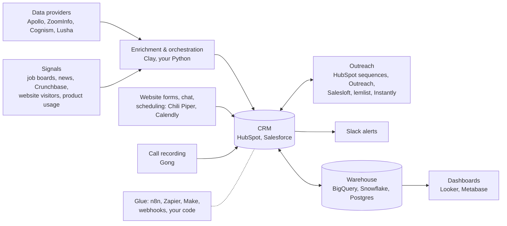

# Module 11: The GTM tool landscape and integrations

You don't need to master every tool, but you must know **what each kind of tool does, how they
connect, and when to write code instead**. Interviewers ask "have you used Clay?", "would you build
this in code or n8n?", "where does a warehouse fit?".

## The landscape at a glance

## Tool categories

| Category | Tools | What they do | What you'd integrate |
| --- | --- | --- | --- |
| CRM | HubSpot, Salesforce, Pipedrive, Attio | System of record | Everything writes here via API |
| Data providers | Apollo, ZoomInfo, Cognism (strong in Europe), Lusha, Dealfront (Europe), Crunchbase | Company and contact data, emails, phones | Enrichment API calls, bulk exports |
| Enrichment / orchestration | **Clay** | Spreadsheet-like tables that call 100+ providers in waterfalls, AI columns, push to CRM | Clay → CRM, webhooks in/out of Clay, or replicate its logic in Python |
| Signals / intent | LinkedIn job posts, news APIs, Crunchbase, website visitor ID (Leadfeeder/Dealfront, RB2B), G2 intent, product analytics | "Why now" events | Scrapers/APIs → scoring → alerts |
| Outreach / sequencing | HubSpot sequences, Outreach, Salesloft, lemlist, Instantly, Smartlead | Multi-step email/LinkedIn/call cadences | Enrolling the right contacts; syncing replies back |
| Scheduling / routing | Chili Piper, Calendly, HubSpot meetings | Book meetings, route inbound to the right rep | Routing rules, webhooks on booking |
| Conversation intelligence | Gong, Chorus, Fathom | Record and transcribe calls | Transcripts → Claude → CRM fields |
| Automation glue | **n8n**, Zapier, Make, HubSpot workflows | Connect tools with triggers and actions | Quick integrations; code nodes |
| Warehouse | BigQuery, Snowflake, Postgres, Redshift | Store all data for analysis and history | ELT from CRM and tools; SQL models |
| Transformation | dbt | Version-controlled SQL models in the warehouse | Clean "accounts" and "funnel" tables |
| Reverse ETL | Hightouch, Census | Push warehouse data back into the CRM | Scores/segments from SQL → CRM fields |
| Communication | Slack | Alerts, approvals | Incoming webhooks, Slack apps |
| AI | Claude API, Claude Code | Research, classification, drafting, building | Pipeline steps, agents |

## Clay in more detail (named in the job post as a nice-to-have)

- A **table** where each row is a company or person and each column is a step: import → find domain →
  enrich (waterfall across providers) → AI column ("summarise their website") → formula (score) →
  push to HubSpot or a sequencer.
- **Waterfalls:** try provider A, then B, then C until a value is found; pay only for hits.
- **Credits:** each enrichment costs credits; design to avoid re-enriching.
- **Webhooks:** Clay tables can receive data via webhook and send rows out via HTTP API columns.
- **Clay vs Python:** Clay is fast to build, great for exploration and non-engineers. Python is better
  for complex logic, testing, version control, high volume, cost control and reliability. Many teams
  use both.

You've used Apollo and Clay in the ConsultKumar outbound workflow; be ready to describe what you did
with them concretely.

## n8n / Zapier / Make

Visual workflows: **trigger** (new form submission, schedule, webhook) → **actions** (HTTP request,
CRM update, Slack message), with branches and loops. n8n can be self-hosted and has code nodes (JS or
Python).

## Code vs no-code: how to decide

| Choose no-code (n8n, Zapier, HubSpot workflows) when… | Choose code when… |
| --- | --- |
| Simple trigger → action, low volume | Complex logic (dedupe, scoring with many rules, entity resolution) |
| Non-engineers need to change it | It must be tested, versioned, reviewed |
| Speed to first version matters most | High volume, rate limits, batching, retries matter |
| The tools have native connectors | You need AI with validation, or unusual APIs |
| | Cost per task would explode at scale |

> "I'd use HubSpot workflows or n8n for simple glue that ops people should be able to change, and Python
> for the core data layer: dedupe, scoring, enrichment and CRM writes, where I need tests, retries and
> version control."

## Warehouses and the "central data layer"

The job post mentions "a central data layer". As a company grows, data from the CRM, product, billing,
outreach and website lands in a **warehouse**, gets modelled with SQL (often dbt), and powers
reporting, scoring and reverse ETL. For a 36-person company, the CRM may be the data layer at first;
a warehouse becomes useful when you need history, joins across many tools and heavier analysis. Being
able to say *when* you'd introduce one is a good systems-thinking answer.
