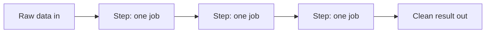

# Chapter 0: Every concept from zero

Read this first if any word in the other chapters is new. Each idea comes with: **what it is in plain
words**, **an everyday picture**, **what it looks like in code**, and **where it shows up in the
pipeline**. At the end, one real record is followed through every step with its actual values.

---

## 0.1 What a "GTM data pipeline" is

**Plain words:** a set of small programs that run one after another. Each takes data in, does one job
(clean it, remove duplicates, add missing facts, score it) and passes the result on. At the end, the
sales team's CRM holds a clean, scored list of who to contact, why, and who owns them.

**Picture:** a restaurant kitchen. Deliveries arrive from different suppliers (data sources). Someone
washes and chops (cleaning). Someone throws out the duplicate order tickets (dedupe). Someone adds
the missing garnish (enrichment). The head chef decides what goes out first (scoring), which waiter
takes it (routing), and it's served (CRM + outreach). If a step is skipped, the plate that reaches the
customer is wrong, even if every other step was perfect.

**GTM** = go-to-market: everything a company does to find, win and keep customers (marketing, sales
development, account executives, customer success).

**Why it's code and not clicking:** clicking works for one list once. A pipeline runs every day on
thousands of records, must give the same result each time, must recover from errors and must be
explainable. That needs code (or carefully built no-code automations).



---

## 0.2 Data words: record, field, table, schema

| Word | Plain meaning | Example |
| --- | --- | --- |
| **Record** (row) | One thing: one person, one company | Lena Vogel at Opal Analytics |
| **Field** (column, property, attribute) | One fact about it | `email`, `title`, `country` |
| **Value** | What the field holds for that record | `"lena@opalanalytics.de"` |
| **Table** (dataset, sheet, DataFrame) | Many records with the same fields | `leads_raw.csv`, 25 rows |
| **Schema** | The list of fields and what type each must be | `email: text, employees: whole number` |
| **Entity** | The real-world thing records describe | The actual company Opal Analytics |
| **Object type** (in a CRM) | A kind of entity | Company, Contact, Deal |

In Python, one record is usually a **dict** and a table is a **list of dicts** (or a pandas
DataFrame):

```python
record = {"company": "Opal Analytics", "email": "lena@opalanalytics.de", "employees": 25}
table = [record, {"company": "Kite Labs", "email": "ravi@kitelabs.io", "employees": 8}]
print(table[0]["email"])          # lena@opalanalytics.de
```

**Why schema matters:** if Apollo calls it `organization.name`, Clay calls it `Company Name` and the
webinar tool calls it `Organisation`, nothing downstream can work until they're all mapped to one
field called `company`. That mapping is step 2 ([chapter 03](03-cleaning-normalisation-validation.md)).

---

## 0.3 Keys: how you know two records are the same thing

**Plain words:** a **key** is a field (or combination) that identifies one entity.

| Kind | Meaning | Example |
| --- | --- | --- |
| **Natural key** | A real-world value that's unique | email for a person, website domain for a company |
| **Surrogate key** | An ID a system made up | HubSpot company id `1001`, Apollo id `ap_3` |
| **Unique key** | The system refuses two records with the same value | HubSpot property with `hasUniqueValue: true` |
| **Foreign key** | A field pointing at another record | a contact's `account_id` = the company's `id` |
| **Composite key** | Several fields together | `first_name + last_name + domain` when there's no email |
| **Match key** | A normalised version used only for comparing | `"peopleco"` from `"PeopleCo GmbH"` |

**Picture:** your passport number identifies you no matter how your name is spelled on a booking. A
company's domain plays that role in GTM: "PeopleCo GmbH", "Peopleco" and "PEOPLECO GMBH" are three
spellings, but `peopleco.de` is one key.

**In the pipeline:** email is the contact key, domain is the account key. Dedupe groups by them, and
the CRM upsert uses them so a re-run updates instead of creating duplicates.

---

## 0.4 Data types, and why `"120"` is not `120`

| Type | Python | Example | GTM trap |
| --- | --- | --- | --- |
| Text | `str` | `"CTO"` | `"120"` looks like a number but `"120" > "50"` is **False** (compared letter by letter) |
| Whole number | `int` | `120` | Providers send `"51-200"` or `"abc"`; must parse |
| Decimal | `float` | `0.92` | Phone numbers read as floats become `4.93e+10` |
| True/false | `bool` | `True` | `"False"` (a string) is truthy! |
| Nothing | `None` | `None` | Different from `""` and from pandas `NaN`, but all mean "blank" |
| List | `list` | `["funding_seed", "hiring_security"]` | Order matters, duplicates allowed |
| Dictionary | `dict` | `{"email": "..."}` | Key lookups are instant |
| Set | `set` | `{"gmail.com", "yahoo.com"}` | No duplicates, instant "is it in there?" checks |

```python
print("120" > "50")            # False  (text comparison: "1" < "5")
print(int("120") > int("50"))  # True
print(bool("False"))           # True   (any non-empty string is truthy)
```

**Blank handling:** decide once what "blank" means and use one helper everywhere:

```python
def blank(v):
    return v is None or (isinstance(v, str) and not v.strip())
```

Deep dive: [15-deep-dives/01-data-types-and-structures.md](../15-deep-dives/01-data-types-and-structures.md).

**Choosing a structure:**

| Need | Use | Why |
| --- | --- | --- |
| Keep records in order | `list` | Simple, ordered |
| Find a record by key fast | `dict` (`{domain: record}`) | O(1) lookup instead of scanning the list |
| "Have I seen this?" / suppression lists | `set` | O(1) membership |
| Count things | `collections.Counter` | `Counter(tiers)` → `{"A": 1, "B": 3}` |
| Group things | `collections.defaultdict(list)` | `groups[domain].append(rec)` without checking first |
| Table maths, joins, CSV | pandas `DataFrame` | Vectorised, `groupby`, `merge` |

---

## 0.5 File formats: CSV, JSON, JSONL

**CSV** (comma-separated values): a table as text. First line = headers.

```
company,website,contact_email,employees
Opal Analytics,opalanalytics.de,lena@opalanalytics.de,25
```

**JSON** (JavaScript Object Notation): nested data, what every API sends.

```json
{"people": [{"first_name": "Lena", "organization": {"name": "Opal Analytics"}}],
 "pagination": {"page": 1, "total_pages": 3}}
```

**JSONL** (JSON Lines): one JSON object per line. Perfect for raw landing files (append-only,
streamable).

```python
import csv, json
rows = list(csv.DictReader(open("data/leads_raw.csv", encoding="utf-8")))   # list of dicts
body = json.loads('{"people": [{"first_name": "Lena"}]}')                    # str -> dict
print(body["people"][0]["first_name"])                                        # Lena
safe = body.get("organization", {}).get("name")                              # None, no crash
```

`.get()` with a default is how you read nested API data safely: real responses often miss keys.

---

## 0.6 How programs talk: APIs and HTTP

**Plain words:** an **API** (Application Programming Interface) is a door into another company's
system that programs (not people) use. You send a **request**, you get a **response**.

**Picture:** a restaurant order. The **URL** is which restaurant and which counter; the **method** is
what you want to do (look at the menu, place an order, change it, cancel it); **headers** are your
membership card and language; the **body** is your order; the **status code** is the waiter's
answer ("here you go", "you're not a member", "kitchen's busy, come back in 10 seconds").

### The parts of a request

```
POST https://api.apollo.io/api/v1/mixed_people/api_search?page=1&per_page=100
└┬─┘ └─────────┬──────────┘└─────────────┬──────────────┘└────────┬────────┘
method        host (server)            path (endpoint)        query parameters
Headers:  x-api-key: abc123            Content-Type: application/json
Body:     {"person_titles": ["CTO"], "organization_locations": ["Germany"]}
```

| Method | Meaning | GTM example |
| --- | --- | --- |
| `GET` | Read | List HubSpot companies |
| `POST` | Create, or send a query/batch | Apollo search, HubSpot batch upsert |
| `PATCH` | Change some fields | Update one company's score |
| `PUT` | Replace / set | Create an association |
| `DELETE` | Remove (archive) | Archive a duplicate |

### Status codes (memorise the families)

| Code | Meaning | What your code does |
| --- | --- | --- |
| 200 OK, 201 Created, 204 No Content | Success | Read the body (204 has none) |
| 207 Multi-Status | Batch partly succeeded | Check each record's result |
| 400 Bad Request | Your request is malformed | Fix the code; **don't retry** |
| 401 Unauthorized | Missing/wrong key | Check the key; don't retry |
| 403 Forbidden | Key is valid but not allowed (scope, plan) | Fix permissions/plan |
| 404 Not Found | Wrong URL or record doesn't exist | For enrichment: "no data" |
| 409 Conflict | Duplicate of a unique value | Use upsert instead of create |
| 422 Unprocessable | Valid JSON, invalid values | Fix the payload |
| **429 Too Many Requests** | Slow down | **Wait and retry** (backoff) |
| 500, 502, 503, 504 | Their server had a problem | **Wait and retry** |

```python
import requests
resp = requests.post(url, json=body, headers={"x-api-key": key}, timeout=30)
print(resp.status_code)        # 200
data = resp.json()             # the body as a dict
resp.raise_for_status()        # raises an exception for 4xx/5xx
```

**SDK** = a library a vendor provides so you don't write raw HTTP (e.g. `anthropic`,
`hubspot-api-client`). Underneath it's the same requests.

Lessons with runnable code: [06-apis-and-webhooks](../06-apis-and-webhooks).

---

## 0.7 Authentication and secrets

| Kind | How it's sent | Used by |
| --- | --- | --- |
| **API key** | A header like `x-api-key: ...` | Apollo, many providers |
| **Bearer token** | `Authorization: Bearer ...` | HubSpot service keys, Anthropic (as `x-api-key`) |
| **OAuth** | The user approves an app; you get tokens that expire and refresh | Apps used by many customers |
| **Scopes** | What the key is allowed to do | `crm.objects.contacts.write` |
| **Webhook secret / signature** | The sender signs each request so you can check it's genuine | HubSpot, Stripe, forms |

**Rule:** keys never go in code or Git. They go in a `.env` file (ignored by Git) locally, and in
GitHub Actions / cloud secrets in production.

```python
import os
from dotenv import load_dotenv
load_dotenv()                                  # reads .env into environment variables
key = os.environ["APOLLO_API_KEY"]             # KeyError if missing: fail fast, clearly
```

---

## 0.8 Pagination from zero

**Plain words:** an API won't send 50,000 records in one reply. It sends a **page** (say 100) plus a
way to ask for the next one. You loop until there is no next page.

**Picture:** a library catalogue printed 100 books per page. You read page 1, note "continue on page
2", read page 2... If you stop after page 1, you think the library has 100 books.

| Style | The "next page" note looks like |
| --- | --- |
| Page number | `"pagination": {"page": 1, "total_pages": 3}` → ask for `page=2` |
| Offset | ask for `offset=100&limit=100` next |
| Cursor | `"paging": {"next": {"after": "MTAw"}}` → send `after=MTAw` |
| Next URL | `"next": "https://.../companies?after=MTAw"` → call that URL |

The loop, in words: *ask for a page → keep its records → is there a next-page note? → if yes, ask
for that; if no, stop.* Code: [chapter 02](02-pagination-rate-limits-batching.md), pattern 4 in
[chapter 15](15-the-6-core-patterns-in-the-pipeline.md).

**Generators** (`yield`) let a function hand records out one page at a time instead of building a
giant list:

```python
def all_people():
    page = 1
    while True:
        body = fetch(page)
        yield from body["people"]          # hand these out, then continue here next time
        if page >= body["pagination"]["total_pages"]:
            return
        page += 1

for person in all_people():                # memory stays small even for 50,000 people
    land(person)
```

---

## 0.9 Rate limits, retries, backoff, jitter

**Rate limit:** "at most N requests per time window". Go faster and you get **429**.

**Picture:** a coffee shop that serves 10 people a minute. If 50 arrive at once, the barista says
"come back in a bit". If all 50 come back at exactly the same second, it happens again. Smart
customers wait longer each time (**exponential backoff**: 1 s, 2 s, 4 s, 8 s) and add a few random
seconds (**jitter**) so they don't return together.

| Word | Meaning |
| --- | --- |
| Retry | Try the same request again |
| Retryable error | One that might succeed later: 429, 5xx, timeouts, connection drops |
| Non-retryable | Will fail the same way: 400, 401, 403, 404, 422 |
| `Retry-After` header | The server tells you how many seconds to wait: obey it |
| Max attempts | Give up after N tries and raise a clear error |
| Throttling | Slowing yourself down *before* you hit the limit |

```python
for attempt in range(1, 6):
    resp = call()
    if resp.status_code not in (429, 500, 502, 503, 504):
        break
    time.sleep(2 ** (attempt - 1) + random.random())   # 1, 2, 4, 8, 16 s + jitter
```

---

## 0.10 Batching

**Plain words:** sending many records in one request instead of one request per record.

**Picture:** posting 100 letters in one parcel instead of 100 trips to the post office.

HubSpot batch endpoints take up to 100 records; Apollo's bulk enrichment takes 10. 1,000 contacts =
10 HubSpot calls instead of 1,000.

```python
for i in range(0, len(records), 100):
    send(records[i:i + 100])          # slices [0:100], [100:200], ...
```

---

## 0.11 Webhooks vs polling

| | Polling | Webhook |
| --- | --- | --- |
| Picture | Checking your letterbox every hour | A doorbell |
| How | Your code asks "anything new?" on a schedule | Their system calls *your* URL when something happens |
| Good for | Sources without webhooks, daily batch runs | Form submissions, deal changes, replies |
| Watch out | Wasted calls, delay | Must verify the signature, answer fast, handle duplicates (senders retry) |

---

## 0.12 Idempotency and upsert

**Idempotent** = doing it twice has the same effect as doing it once.

**Picture:** pressing a lift button. Pressing it five times doesn't call five lifts.

**Upsert** = "update if it exists, insert if it doesn't", matched on a key. It's what makes a CRM sync
idempotent:

| Run | Blind create | Upsert by email |
| --- | --- | --- |
| 1st | 9 contacts created | 9 created |
| 2nd | 9 **more** created (duplicates) | 0 created, 9 updated |

The demo's `--twice` flag proves exactly this.

---

## 0.13 Normalisation

**Plain words:** writing the same thing the same way so a computer can see it's the same.

| Raw values | Normalised |
| --- | --- |
| `Germany`, `Deutschland`, `de`, `DE` | `DE` |
| `https://www.PeopleCo.de/about`, `peopleco.de`, `anna@PeopleCo.de` | `peopleco.de` |
| `51-200`, `120`, `abc` | `125`, `120`, `None` |
| `Software`, `SaaS`, `COMPUTER_SOFTWARE` | `software` |

**Display value vs match key:** keep `"PeopleCo GmbH"` to show reps; compare using `"peopleco"`.

---

## 0.14 Validation and quarantine

**Validation:** rules a record must pass (email looks like an email, not a student, has a company).
**Quarantine:** a side table for records that failed, *with reasons*, so someone can fix the source.

**Picture:** airport security. Most bags go through; a few go to a separate table to be checked by a
person. They're not thrown away.

---

## 0.15 Deduplication and entity resolution

**Dedupe:** remove repeated records of the same entity.
**Entity resolution:** the harder version: deciding whether *different-looking* records are the same
entity ("Nordbank Tech B.V." vs "NORDBANK TECH" vs "Nordbanc Tech").

| Word | Meaning |
| --- | --- |
| Exact match | Same key value after normalising |
| Fuzzy match | "Similar enough" text, measured 0.0–1.0 |
| Threshold | The similarity at which you decide (e.g. ≥ 0.90 merge, 0.75–0.90 ask a human) |
| Blocking | Only compare records likely to match (same country), to save time |
| Survivorship | Rules for which value wins when merging (trusted source, newest, most complete) |
| Golden record | The merged best version |
| Lineage | Remembering which source each value came from |

---

## 0.16 Enrichment, credits, waterfall, cache

**Enrichment:** adding facts you don't have (employee count, industry, verified email) from a
provider.

| Word | Plain meaning | Picture |
| --- | --- | --- |
| Credit | The unit providers charge in | Arcade tokens |
| Waterfall | Ask the cheapest provider first, then the next, until one knows | Ask a colleague, then your manager, then pay a consultant |
| Hit rate | % of lookups that returned data | How often the colleague knew |
| Cache | Saving answers so you never pay twice | Writing the answer in your notebook |
| TTL (time to live) | How long a cached answer is trusted | "Re-check every 90 days" |
| Verification | Checking an email will actually receive mail | Calling a number before printing it |
| Field ownership | Who is allowed to overwrite a field | Only the rep edits the owner field |

---

## 0.17 Suppression, scoring, tiers, segments, routing

| Word | Plain meaning | Example |
| --- | --- | --- |
| ICP (ideal customer profile) | The kind of company most likely to buy | EU software firms, 20–500 staff |
| Persona | The kind of person inside it | CTO, Head of Security |
| Suppression | People you must not contact | Unsubscribed, existing customers, open deals |
| Fit score | How much it looks like a customer | DE + software + 25 staff = high |
| Intent score | Signs it's the right time | Just raised money, hiring a security lead |
| Signal | An event that suggests "now" | Funding round, job post, pricing-page visit |
| Decay | Older signals count less | Funding 6 months ago < last week |
| Tier | A bucket from the score | A ≥ 80, B ≥ 60, C ≥ 40, D below |
| Segment | Group that gets the same message | `software:smb:founder_exec` |
| Routing | Deciding who owns a lead | Keep existing owner; else territory round robin |
| Territory | Region a rep covers | DACH = Germany, Austria, Switzerland |
| Round robin | Assign in turn | Lena, Jonas, Lena, Jonas... |
| SLA | Promised response time | Inbound demo request touched within 15 minutes |

---

## 0.18 The CRM in five ideas

1. **Objects**: companies, contacts, deals (and tickets, custom objects).
2. **Properties**: the fields on each object (`domain`, `gtm_score`). Custom ones you create.
3. **Associations**: links between records (Lena ↔ Opal Analytics ↔ a deal).
4. **Owners**: the rep responsible (`hubspot_owner_id`). Sacred: the pipeline doesn't change it on
   owned records.
5. **Stages**: lifecycle stage (lead → MQL → SQL → customer) and deal stage (discovery → demo →
   proposal → won/lost).

"Single source of truth" = everyone (reps, managers, the pipeline) reads and writes one place, so
nobody keeps a private spreadsheet that disagrees.

More: [07-crm-hubspot/01-crm-concepts.md](../07-crm-hubspot/01-crm-concepts.md).

---

## 0.19 Code ideas the pipeline relies on

### Functions: input → output

```python
def normalise_country(value):        # input: "Germany"
    ...
    return "DE"                      # output: "DE"
```

Small functions that do one job, with no hidden side effects (**pure functions**), are easy to test
and reuse. Most of the pipeline is pure functions; only collection and write-back touch the outside
world.

### Config vs code

Business rules (which countries, score weights, reps per territory) live in a `CONFIG` dict or YAML
file. Changing the ICP should be a config edit reviewed by the Head of GTM, not a code change.

### Errors and exceptions

```python
try:
    result = enrich(domain)
except ValueError as e:              # expected kind of failure: log it and move on
    log.warning("enrich failed for %s: %s", domain, e)
```

`raise` = "stop, something is wrong". `try/except` = "if this kind of thing goes wrong, do this
instead". Catch what you expect; let surprises crash loudly so you notice.

### Logging levels

| Level | Use |
| --- | --- |
| `DEBUG` | Detail while developing |
| `INFO` | Normal progress: "collected 312 rows" |
| `WARNING` | Something odd but handled: "1 record failed enrichment" |
| `ERROR` | A step failed |
| `CRITICAL` | The run can't continue |

### Tests

A test is code that checks other code: `assert normalise_domain("https://www.X.de/a") == "x.de"`.
`pytest` runs them all. CI (GitHub Actions) runs them on every push so a change can't silently
break the pipeline.

### Schedules (cron in one line)

```
30 4 * * 1-5      →  minute 30, hour 4 (UTC), any day of month, any month, Monday–Friday
│  │ │ │ │
│  │ │ │ └ day of week (0=Sun ... 6=Sat)
│  │ │ └── month
│  │ └──── day of month
│  └────── hour
└───────── minute
```

---

## 0.20 One record's journey, with real values

These are the actual values the demo produces for Lena Vogel (run it and check).

**1. Raw (Clay export row):**

```json
{"company": "Opal Analytics", "website": "opalanalytics.de", "contact_name": "Lena Vogel",
 "contact_email": "lena@opalanalytics.de", "title": "CEO", "country": "DE", "city": "Leipzig",
 "employees": "25", "industry": "Software", "source": "clay"}
```

Note `"employees": "25"` is text, and `"Software"` is capitalised.

**2. Mapped to the common schema:** `contact_name` is split into `first_name: "Lena"`,
`last_name: "Vogel"`; `contact_email` → `email`.

**3. Cleaned:** `employees: 25` (a number now), `industry: "software"`, `domain: "opalanalytics.de"`,
derived `seniority: "c_level"`, `function: "executive"`, `is_personal_email: false`. Passes validation.

**4. Deduped + matched to the CRM:** the account `opalanalytics.de` already exists in the CRM (id
`11`) with owner `lena`, so the golden account takes its values from the CRM (`lineage` says `crm`)
and remembers `existing_owner: "lena"`. (That `lena` is a sales rep in the sample CRM, a different
person from the contact Lena Vogel.)

**5. Enriched:** provider B adds `signals: ["funding_seed"]`. Nothing else was missing.

**6. Suppressed?** No: no open deal, not a customer, not unsubscribed.

**7. Scored:**

| Rule | Points |
| --- | --- |
| DE in target countries | 15 |
| DE is a core (DACH) country | +5 |
| industry software | 20 |
| 25 staff within 20–500 | 15 |
| executive = buyer function | 10 |
| CEO = senior | 5 |
| **fit** | **70** |
| recent funding | 20 |
| **intent** | **20** |
| **score / tier** | **90 / A** |

Reasons stored: `DE in target region; software; 25 staff; executive buyer; recent funding`.
Segment: `software:smb:founder_exec`.

**8. Routed:** owner stays `lena` ("kept existing CRM owner").

**9. CRM:** upserted by `email` with `gtm_score=90`, `gtm_tier=A`, reasons, segment. Re-run → updated,
not duplicated.

**10. Outreach draft:** "Hi Lena, congrats on the recent raise. Teams like yours usually get asked for
ISO 27001 or SOC 2 by their first enterprise customers. Worth a 15-minute look?" → status
`DRAFT - needs human approval`.

---

## 0.21 Check yourself

1. Why is domain a better account key than company name?
2. What's the difference between a 401 and a 429, and which one do you retry?
3. You ran the sync twice and the CRM has twice as many contacts. Which idea was missing?
4. Why does `"120" > "50"` return `False`?
5. Polling or webhook for "a demo form was just submitted"? Why?
6. What does a cache save you during enrichment, and why also cache "no data found"?
7. Name three lists you'd suppress before cold outreach.

<details><summary>Answers</summary>

1. Names are spelled many ways ("PeopleCo GmbH", "PEOPLECO"); a normalised domain is one value per company.
2. 401 = wrong/missing key (fix it, don't retry). 429 = too many requests (wait and retry with backoff).
3. Idempotency: writes should be upserts on a unique key.
4. Strings compare character by character; `"1"` comes before `"5"`.
5. Webhook: it's an event and speed-to-lead matters.
6. Credits and time; caching misses stops you paying to ask the same unanswerable question every run.
7. Unsubscribes, bounces, existing customers, open deals, competitors, role inboxes.
</details>
