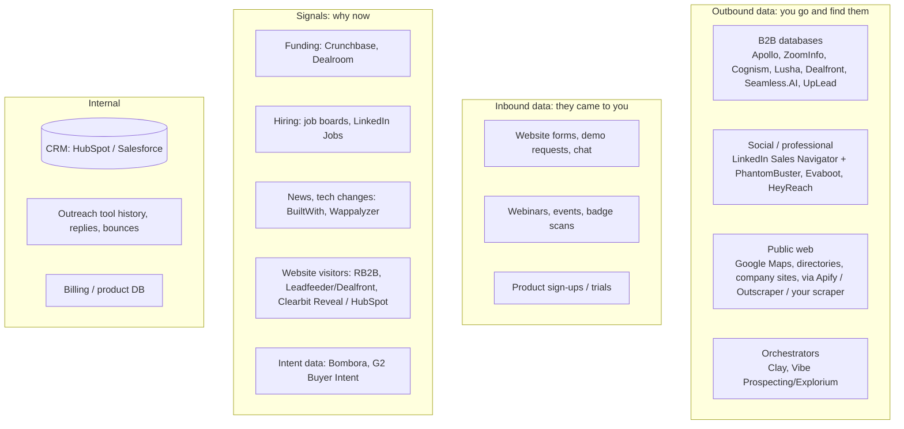

# Step 1: Data sources and collection

**Goal:** get raw records about companies and people out of every place they live and into one
landing area, without losing anything and without paying for the same record twice.

**Output of this step:** raw files/tables, one per source, untouched (`raw_apollo_2026-11-27.json`,
`raw_webinar_2026-11-27.csv` ...). You never clean in place; you keep the raw copy so you can re-run
later steps and explain where every value came from.

## 1.0 Start from zero

**What "collecting" means:** copying information about companies and people from the places it lives
(databases you rent, forms on your website, your own CRM) into one place where your code can work on
it. Nothing is cleaned or judged yet; you're just gathering the ingredients.

**Three ways data reaches you:**

| Way | Plain meaning | Picture | Example |
| --- | --- | --- | --- |
| **Export** (pull by hand) | You click "Download CSV" | Photocopying a page | Apollo list → CSV |
| **API** (pull by code) | Your program asks the other system's API | Ordering by phone, any time, automatically | `POST /mixed_people/api_search` |
| **Webhook** (push) | The other system calls you when something happens | A doorbell | Form submitted → your URL is called |

**Why you always keep the raw copy:** if a later step has a bug, you fix it and re-run from the raw
copy instead of paying the provider again. And when a rep asks "where did this phone number come
from?", the raw file answers.

**Search vs enrichment, from zero:** a *search* is "show me CTOs at German software companies with
20–500 staff" and returns names, titles and companies (often free or cheap). *Enrichment* is "give me
the verified email and phone for this specific person" and costs credits. So: search wide, filter
hard, enrich only the survivors.

**Words used in this chapter:** source, export, API, endpoint, API key, webhook, landing zone (raw
storage), run id (a label for one execution), credits, data contract (the fields you expect).
All explained in [chapter 0](00-basics-from-zero.md).

## 1.1 The four families of sources



## 1.2 Every common tool: what it gives you, click way, code way

| Tool | What you get | Click way (no code) | Code way (API) | Notes |
| --- | --- | --- | --- | --- |
| **Apollo.io** | ~275M contacts, companies, emails, phones, intent filters, sequences | Search with filters → select → *Export CSV* or *Add to sequence* | `POST /api/v1/mixed_people/api_search` (search, no emails), `POST /api/v1/people/bulk_match` (enrich, up to 10 per call), `POST /api/v1/mixed_companies/search`, `POST /api/v1/organizations/bulk_enrich` | People search is capped at 100 per page / 500 pages (50,000 rows) and needs a **master API key**; emails only come from the enrichment endpoints, which cost credits. Free plans can't use every endpoint. |
| **ZoomInfo** | Large US-heavy contact + company DB, intent, org charts | Search → export / push to CRM | Enrich + Search APIs, async bulk jobs | Enterprise pricing |
| **Cognism** | Strong EU coverage, phone-verified mobiles ("Diamond Data"), GDPR-checked | Prospector UI → export / CRM sync | REST API (enrich, search) | Good for DACH / EU targets |
| **Lusha** | Emails + phones, Chrome extension | Extension on LinkedIn → reveal → export | Person/Company API, bulk | Credit based |
| **Dealfront (Leadfeeder + Echobot)** | EU company DB + website visitor identification | Filter → list → export | API | GDPR-oriented, strong in Germany |
| **LinkedIn Sales Navigator** | Best "who works where now" data, job changes, saved-lead alerts | Saved searches, lead lists, InMail | **No public data API.** Teams export with tools (Evaboot, PhantomBuster) | Scraping LinkedIn breaks its User Agreement: account bans are real. Prefer manual lists or tools that work through your own session at low volume. |
| **Clay** | Spreadsheet-like tables that pull from 100+ providers, AI research columns (Claygent), waterfalls, CRM push | Build a table: import → enrich columns → formula → push to HubSpot | Inbound **webhook source** per table (POST JSON → new row), **HTTP API column** to call any API, **HTTP API as source** (with pagination), CRM actions | Webhook sources are rate limited (Clay support cites ~10 records/sec) and have a 50,000-submission lifetime per webhook; payloads must be small (100 KB). |
| **Vibe Prospecting (Explorium)** | Company/prospect search, enrichment, events (funding, hiring) | Chat-style search | API / MCP tools: `fetch-entities`, `enrich-business`, `fetch-businesses-events` | Credit based; estimate cost first |
| **Crunchbase / Dealroom** | Funding rounds, investors, founders | Search → export | REST API (paid) | Funding is a top "why now" signal |
| **Google Maps (via Outscraper, Apify, SerpAPI)** | Local businesses: name, phone, website, reviews | Run an actor/task in the UI → download CSV | Their REST APIs | For local-SMB ICPs (restaurants, clinics, billing companies) |
| **Apify / PhantomBuster** | Ready-made scrapers ("actors"/"phantoms") for sites, directories, LinkedIn | Configure → run → CSV/JSON | Start runs + fetch datasets by API | Respect each site's terms and robots.txt |
| **BuiltWith / Wappalyzer** | Tech stack per domain (uses HubSpot? AWS? Stripe?) | Lookup / list export | Domain API | Technographic fit and signals |
| **Hunter.io** | Domain search (emails at a domain), email finder, verifier | Domain search → export | `/v2/domain-search`, `/v2/email-finder`, `/v2/email-verifier` | Has a free tier, good for testing |
| **Website forms** (HubSpot forms, Typeform, Webflow) | Inbound leads | Form submissions view → export | Webhook on submit, or HubSpot Forms API | Fastest-to-convert source |
| **Webinars / events** (Zoom, Livestorm, Hopin, badge scanners) | Registrants, attendees, engagement | Export CSV | Zoom/Livestorm APIs, webhooks | Usually messy: mixed casing, personal emails |
| **CRM** (HubSpot, Salesforce, Pipedrive) | What you already know: accounts, owners, deals, customers | Views → export | `GET /crm/v3/objects/companies` (cursor pagination), search API | You **always** pull the CRM too: you need it to dedupe and to avoid emailing customers |
| **Product DB / billing** (Postgres, Stripe) | Sign-ups, usage, plan | — | SQL, Stripe API | Product-qualified leads (PQLs) |

## 1.3 The process

1. **Define what you're looking for first** (the ICP, chapter 07): countries, industries, size,
   personas. Filters at the source are cheaper than filtering after you've paid for the data.
2. **Pick sources per purpose**: one database for net-new (Apollo / Cognism), the CRM for what you
   already have, inbound sources for intent, signal sources for timing.
3. **Choose the access method per source**:
   - *One-off or small list?* Export a CSV by clicking. Totally fine.
   - *Recurring, large, or needs to be trusted?* Use the API in code, on a schedule.
   - *Event-driven (form submitted, deal changed)?* Receive a **webhook**.
4. **Pull with pagination, retries and a credit budget** (chapter 02).
5. **Land the raw data unchanged**, with metadata: source, pulled_at, query/filter used, run_id.
6. **Log counts**: how many rows per source, pages, retries, credits. A source that suddenly returns
   0 rows is an incident, not a quiet day.

## 1.4 Concepts to know

| Concept | Meaning | Why it matters |
| --- | --- | --- |
| **Search vs enrichment** | Search finds *who* matches filters (cheap or free); enrichment returns *contact details* for known people (costs credits) | Search wide, enrich only the people who pass your filters |
| **Credits** | The unit providers bill in, often charged only when data is returned | Budget per run; cache results; never re-enrich |
| **API key types** | Apollo has normal and master keys; HubSpot uses service keys (Bearer token) since late 2026; OAuth for multi-tenant apps | Wrong key = 401/403 |
| **Export vs sync** | Export = a CSV snapshot; sync = continuous connection | Exports go stale; syncs need dedupe rules |
| **Webhook** | The other system calls *your* URL when something happens | Real-time inbound, no polling |
| **Landing zone / raw layer** | Store raw responses before transforming | Re-run, audit, debug ("where did this value come from?") |
| **Data contract** | The fields + types you expect from each source | Detect when a source changes its format |
| **Lawful basis** | GDPR needs a reason to process personal data (B2B outbound usually relies on legitimate interest) | See chapter 06 |

## 1.5 The code

### A. A reusable API client (the shape every source uses)

```python
import os, requests

session = requests.Session()                       # reuses the TCP connection: faster
session.headers.update({
    "Content-Type": "application/json",
    "x-api-key": os.environ["APOLLO_API_KEY"],     # key from .env, never hard-coded
})

def apollo_people_search(page, per_page=100, **filters):
    body = {"page": page, "per_page": per_page, **filters}
    resp = session.post("https://api.apollo.io/api/v1/mixed_people/api_search",
                        json=body, timeout=30)      # ALWAYS set a timeout
    resp.raise_for_status()                         # 4xx/5xx -> exception (caught by retry, ch. 02)
    return resp.json()

first = apollo_people_search(1, person_titles=["CTO", "Head of Security"],
                             organization_locations=["Germany", "Austria"],
                             organization_num_employees_ranges=["20,500"])
print(first["pagination"])                          # {'page': 1, 'per_page': 100, 'total_entries': ..., 'total_pages': ...}
```

Filter names (`person_titles`, `organization_locations`, `organization_num_employees_ranges`) come
from Apollo's API reference; check it for the current list.

### B. Enrich only the people who passed the filters (batches of 10)

```python
def apollo_bulk_enrich(people):                    # people = [{"first_name","last_name","domain"}, ...]
    out = []
    for i in range(0, len(people), 10):             # Apollo bulk_match: max 10 per call
        resp = session.post("https://api.apollo.io/api/v1/people/bulk_match",
                            json={"details": people[i:i + 10]}, timeout=30)
        resp.raise_for_status()
        out.extend(resp.json().get("matches", []))
    return out
```

### C. Files from clicking (Clay export, webinar list, badge scans)

```python
import pandas as pd
webinar = pd.read_csv("raw/webinar_2026-11-20.csv", dtype=str, keep_default_na=False)
webinar["source"] = "webinar"                      # tag the source on EVERY row
webinar["pulled_at"] = "2026-11-27T09:00:00Z"
```

`dtype=str` stops pandas turning `"0049..."` phone numbers or ZIP codes into numbers;
`keep_default_na=False` keeps empty cells as `""` instead of `NaN` until you decide what blank means.

### D. Inbound in real time: a webhook receiver (Flask)

```python
from flask import Flask, request, abort
import hmac, hashlib, json, os

app = Flask(__name__)
SECRET = os.environ["FORM_WEBHOOK_SECRET"].encode()
seen_ids = set()                                    # use a DB table in production

@app.post("/webhooks/form")
def form_submitted():
    sig = request.headers.get("X-Signature", "")
    expected = hmac.new(SECRET, request.data, hashlib.sha256).hexdigest()
    if not hmac.compare_digest(sig, expected):      # 1. verify it's really from the sender
        abort(401)
    event = request.get_json()
    if event["id"] in seen_ids:                     # 2. senders retry: dedupe by event id
        return "", 200
    seen_ids.add(event["id"])
    with open("raw/inbound_events.jsonl", "a") as f:  # 3. land it raw, process asynchronously
        f.write(json.dumps(event) + "\n")
    return "", 200                                   # 4. answer fast (< a few seconds) or they retry
```

Full lesson: [06-apis-and-webhooks/04-webhooks.md](../06-apis-and-webhooks/04-webhooks.md).

### E. Pushing rows into Clay by code (Clay webhook source)

```python
CLAY_WEBHOOK = os.environ["CLAY_TABLE_WEBHOOK_URL"]  # the URL is the secret: never commit it
for row in rows:
    requests.post(CLAY_WEBHOOK, json=row, timeout=15).raise_for_status()
    time.sleep(0.12)                                # stay under ~10 rows/second
```

Clay then runs every enrichment column on the new row and can push the result to HubSpot or back to
your endpoint with an HTTP API column.

### F. Land raw, with metadata

```python
import json, datetime, uuid, pathlib
run_id = uuid.uuid4().hex[:8]
path = pathlib.Path(f"raw/apollo/{datetime.date.today()}_{run_id}.jsonl")
path.parent.mkdir(parents=True, exist_ok=True)
with path.open("w") as f:
    for person in people:
        f.write(json.dumps({"_source": "apollo", "_run_id": run_id,
                            "_pulled_at": datetime.datetime.utcnow().isoformat(), **person}) + "\n")
```

In the demo: `collect()`, `FakeApolloPeopleSearch`, `FakeHubSpotCompanies` in
[code/pipeline_end_to_end.py](code/pipeline_end_to_end.py).

## 1.6 Pitfalls

- Exporting from five tools by hand every week: you get five slightly different versions of the truth.
- Paying to enrich everyone a search returns, before filtering.
- Not pulling the CRM, then emailing existing customers.
- Scraping sites against their terms (LinkedIn especially). Cheap now, expensive later.
- Forgetting to tag `source` on every row: you can't do survivorship (chapter 04) or attribution
  (chapter 12) later.

## 1.7 Interview lines

> "I separate search from enrichment: search is cheap, so I search wide, filter on ICP rules, and only
> enrich the survivors, in batches, with a credit budget per run. Every source lands raw with a source
> tag and run id, and I always pull the CRM too, because dedupe and suppression need it."

> "For one-off lists, a CSV export is fine. Once a list is recurring or feeds the CRM, it becomes code
> on a schedule, or a webhook if it's event-driven."

## 1.8 Summary

- Data comes from **outbound databases** (Apollo, Cognism...), **inbound** (forms, webinars),
  **signals** (funding, hiring, visits) and **your own CRM**: always pull the CRM too.
- Choose the access method by need: **CSV export** for one-offs, **API in code** for recurring work,
  **webhooks** for real-time events.
- **Search is cheap, enrichment costs credits.** Filter before you enrich.
- **Land raw data unchanged** with `source`, `run_id` and `pulled_at` on every row.
- Log counts per source: zero rows from a source is an incident.

## 1.9 Key functions to remember

| Function (demo or chapter) | Input → output | Why it exists |
| --- | --- | --- |
| `apollo_people_search(page, **filters)` | filters → one page of people JSON | One place for the URL, headers, timeout |
| `apollo_bulk_enrich(people)` | ≤10 people per call → matches | Respect the bulk limit |
| `form_submitted()` (Flask) | signed webhook → raw JSONL line | Verify, dedupe by event id, land, answer fast |
| `collect()` (demo) | nothing → `raw` dict of sources + stats | Runs every source with pagination + retry |
| `read_csv(path)` (demo) | path → list of dicts | Files from exports |

## 1.10 Important logic

| Situation | Decision |
| --- | --- |
| A list you need once, under a few hundred rows | Export CSV by clicking |
| A list you need every week, or that writes to the CRM | API in code, on a schedule |
| Something that happens at an unpredictable moment (form, reply, deal change) | Webhook |
| A search returns more than you can afford to enrich | Tighten filters, enrich only ICP-passing rows |
| A source returns 0 rows today but ~300 usually | Stop the run and alert; don't write anything |

## 1.11 Check yourself

1. Why should every raw row carry a `source` field? Name two later steps that need it.
2. Apollo's people search returns no emails. Which endpoint gives them, and what does it cost?
3. Your webhook endpoint takes 20 seconds to process each event. What goes wrong, and what's the fix?
4. Why is scraping LinkedIn a bad foundation for a company's pipeline?

<details><summary>Answers</summary>

1. Survivorship (which source wins in dedupe) and attribution/reporting (which source produced pipeline).
2. `people/bulk_match` (or `people/match`); it consumes credits per matched person.
3. The sender times out and retries, creating duplicates and load. Verify, store the raw event, return 200 immediately, process asynchronously.
4. It breaks LinkedIn's terms; accounts get restricted, and the data flow can stop at any time.
</details>
