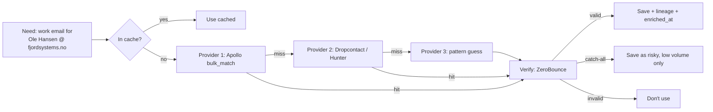

# Step 5: Enrichment and verification

**Goal:** fill the fields scoring and outreach need (employee count, industry, country, tech stack,
verified work email, phone, LinkedIn URL, signals) at the lowest cost, with known confidence, and keep
them fresh.

## 5.1 Kinds of enrichment

| Kind | Fields | Typical providers |
| --- | --- | --- |
| **Firmographic** | employees, industry, revenue band, HQ country, founded year, funding | Apollo, ZoomInfo, Cognism, Clearbit/HubSpot Breeze Intelligence, Crunchbase, Dealfront, PeopleDataLabs |
| **Technographic** | tools they use (HubSpot, AWS, Okta, Jira...) | BuiltWith, Wappalyzer, HG Insights, Apollo tech filters |
| **Contact** | work email, mobile, direct dial, LinkedIn URL | Apollo, Cognism, Lusha, ZoomInfo, Hunter, Dropcontact (EU, no database: finds emails from patterns), Kaspr, Prospeo, FindyMail |
| **Signals / intent** | funding, hiring, job changes, news, web visits, review-site intent | Crunchbase, job boards, Bombora, G2, RB2B, Common Room, UserGems (job changes) |
| **AI research** | free-text facts ("do they mention ISO 27001 on their site?", "who are their customers?") | Clay Claygent, Claude with web search, Perplexity API |
| **Email verification** | deliverable / risky / invalid / catch-all | ZeroBounce, NeverBounce, MillionVerifier, Bouncer, Kickbox, Hunter verifier |

## 5.2 Click vs code

| Way | What it looks like | Good for |
| --- | --- | --- |
| **Clay (click)** | Add enrichment column → pick providers in a **waterfall** → "only run if empty" → formula → push to CRM | Fast experiments, non-engineers, 100+ providers without 100 contracts |
| **Native CRM enrichment (click)** | HubSpot Breeze Intelligence / Salesforce + ZoomInfo app auto-fill fields | Low effort, low control |
| **Provider UI (click)** | Upload CSV to Apollo / Cognism / ZeroBounce → download enriched CSV | One-off lists |
| **Python (code)** | Call each provider's API in a waterfall with caching, budgets, confidence and tests | Volume, cost control, custom logic, reliability |
| **Hybrid** | Your code sends rows to a Clay webhook table; Clay enriches; Clay's HTTP API column posts results back | Using Clay's provider network inside a coded pipeline |

## 5.3 The process

1. **Decide which fields matter** (only what scoring, routing or messaging use). Every extra field is
   cost and decay.
2. **Check what you already have** (CRM, earlier runs, cache). Enrich only **missing or stale** fields.
3. **Run a waterfall** per field: cheapest/most accurate provider first, stop at the first good hit.
4. **Record source, confidence and enriched_at** per field (lineage).
5. **Verify emails** before any outreach; drop invalids, treat catch-alls as risky.
6. **Respect field ownership**: enrichment fills blanks and updates machine-owned fields; it never
   overwrites values a rep typed.
7. **Cache every response** (hits *and* misses) with a TTL, so re-runs cost nothing.
8. **Track cost**: credits per run, cost per enriched contact, hit rate per provider. Drop providers
   that don't pay for themselves.
9. **Refresh on a schedule**: people change jobs (B2B data decays roughly 20–30% a year is the usual
   industry estimate), so re-verify active pipeline contacts every few months.

## 5.4 The waterfall



```python
import json, time, pathlib

CACHE = pathlib.Path("cache/enrichment.json")
cache = json.loads(CACHE.read_text()) if CACHE.exists() else {}
TTL_DAYS = 90

def cached(provider, key, fetch):
    k = f"{provider}:{key}"
    hit = cache.get(k)
    if hit and time.time() - hit["at"] < TTL_DAYS * 86400:
        return hit["data"], False                         # (data, charged?)
    data = fetch(key)                                      # real API call
    cache[k] = {"at": time.time(), "data": data}          # cache misses too: don't re-ask tomorrow
    return data, data is not None

WATERFALL = [("apollo", apollo_org_enrich, 1), ("clearbit", clearbit_lookup, 2), ("pdl", pdl_company, 3)]

def enrich_company(domain, account, budget):
    missing = [f for f in ("employees", "industry", "country") if not account.get(f)]
    spent = 0
    for name, fetch, cost in WATERFALL:
        if not missing: break
        if spent + cost > budget: break
        data, charged = cached(name, domain, fetch)
        spent += cost if charged else 0
        for f in list(missing):
            if data and data.get(f):
                account[f] = data[f]
                account.setdefault("lineage", {})[f] = {"source": name, "at": time.time()}
                missing.remove(f)
    CACHE.write_text(json.dumps(cache))
    return spent
```

## 5.5 Finding and verifying emails

### Pattern guessing (when you have name + domain)

Most companies use one pattern for everyone. Learn it from any **known** email at the domain, or try
the common ones, then **verify**.

```python
def candidates(first, last, domain):
    f, l = first.lower(), last.lower().replace(" ", "")
    return [f"{f}.{l}@{domain}", f"{f}@{domain}", f"{f[0]}{l}@{domain}",
            f"{f[0]}.{l}@{domain}", f"{f}{l}@{domain}", f"{l}@{domain}"]

def learn_pattern(known_email, first, last):
    local = known_email.split("@")[0]
    for name, fn in {"first.last": lambda: f"{first}.{last}", "first": lambda: first,
                     "flast": lambda: f"{first[0]}{last}"}.items():
        if local == fn().lower():
            return name
```

### Verification

```python
resp = requests.get("https://api.zerobounce.net/v2/validate",
                    params={"api_key": os.environ["ZEROBOUNCE_KEY"], "email": email}, timeout=20)
status = resp.json()["status"]        # valid / invalid / catch-all / unknown / spamtrap / abuse / do_not_mail
```

| Status | Action |
| --- | --- |
| valid | OK to sequence |
| catch-all / accept-all | Domain accepts everything, so the mailbox can't be confirmed: low volume only, or skip |
| invalid / spamtrap / abuse | Never send |
| unknown | Retry later |

Never send to unverified guesses: bounces above ~2–3% damage your sending domain's reputation
(chapter 09).

## 5.6 AI enrichment with Claude (structured, validated)

```python
import anthropic, json
client = anthropic.Anthropic()
ALLOWED = ["software", "fintech", "healthtech", "insurtech", "logistics", "manufacturing", "other"]

prompt = f"""Classify this company. Reply with JSON only:
{{"industry": one of {ALLOWED}, "sells_to_enterprise": true/false, "evidence": "<= 20 words"}}
Company: {name}. Website text: {homepage_text[:4000]}"""

msg = client.messages.create(model="claude-haiku-5-5", max_tokens=200, temperature=0,
                             messages=[{"role": "user", "content": prompt}])
data = json.loads(msg.content[0].text)
if data.get("industry") not in ALLOWED:            # validate: never trust free text
    data["industry"] = None
```

Rules: give a closed list of answers, ask for evidence, validate, cache per domain, use the smallest
model that's accurate on a labelled sample, and never let AI overwrite a provider fact it can't cite.
Check the current model names in Anthropic's docs. More: [09-claude-and-ai](../09-claude-and-ai).

## 5.7 Clay equivalent (click path)

1. Table → *Import* (CSV / webhook / HubSpot list).
2. *Add enrichment* → "Find company domain" → "Enrich company" with a waterfall (e.g. Clearbit →
   Apollo → PeopleDataLabs), *Run only if* `Employee Count is empty`.
3. *Find work email* waterfall → *Validate email* column.
4. *Claygent / AI* column: "Does this company mention ISO 27001 or SOC 2 on its website? yes/no + quote".
5. *Formula* column: score. *Filter*: score ≥ 60.
6. *Send to HubSpot* action: upsert by domain/email, map columns to properties.

Same logic as the Python, so you can explain both.

In the demo: `enrich()` runs a two-provider waterfall with a cache and a 40-credit budget. Employee
count goes from 17 to 19 of 19 accounts, 21 credits are used, and the second run uses **0** because
every lookup is cached. `guess_email_patterns()` shows the pattern step.

## 5.8 Pitfalls

- Enriching before deduping (you pay twice for the same company).
- No cache: each re-run costs the full budget again.
- Overwriting a rep's corrected title with stale provider data.
- Trusting catch-all emails as valid.
- Storing more personal data than you use (GDPR data minimisation).

## 5.9 Interview lines

> "Enrichment only fills missing or stale fields, through a waterfall from cheapest to most expensive
> provider, with a cache and a per-run credit budget. Every field keeps its source and date. Emails are
> verified before anything is sent, and catch-alls are treated as risky."
