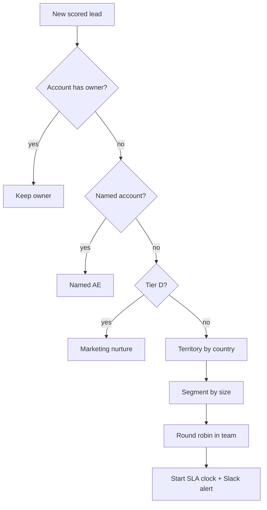

# Steps 6 and 8: Suppression, compliance and routing

Two gates that protect the company and the reps:

- **Suppression** decides who must **not** be contacted (or not by cold outbound).
- **Routing** decides **who owns** each lead/account and how fast they must act.

## 6.1 Suppression: who never gets a cold email

| List | Why | Where it comes from |
| --- | --- | --- |
| Unsubscribed / opted out | Legal (GDPR, ePrivacy, CAN-SPAM, UK PECR) and trust | Outreach tool unsubscribes, CRM `hs_email_optout`, replies "remove me" |
| Hard bounces / invalid | Protect sending reputation | Verifier, outreach tool bounce webhooks |
| Existing customers | Belong to account management / expansion, not cold outbound | CRM deals `closed_won`, billing |
| Open deals | The AE is already talking to them; a cold email embarrasses everyone | CRM deals in an open stage |
| Competitors and partners | Obvious | Maintained list of domains |
| Recently contacted | Don't hit the same person from two sequences | Outreach tool activity, `last_contacted` |
| Role inboxes (`info@`, `sales@`) | Low reply, high spam-complaint risk | Derived in cleaning |
| Do-not-contact accounts | Legal hold, bad past experience, a big partner | CRM flag |
| Regions you can't legally email cold | Some countries require opt-in for B2B email too (Germany's UWG is strict) | Legal guidance per country |

### Code

```python
customers = {domain_of[d["account_id"]] for d in deals if d["stage"] == "closed_won"}
open_deal = {domain_of[d["account_id"]] for d in deals if d["stage"] not in ("closed_won", "closed_lost")}

def suppress_reason(c):
    if c["email"] in unsubscribed:                 return "unsubscribed"
    if c["email"] in bounced:                      return "bounced"
    if c["domain"] in competitor_domains:          return "competitor"
    if c["domain"] in customers:                   return "existing_customer"   # -> expansion play
    if c["domain"] in open_deal:                   return "open_deal"           # -> tell the AE
    if c["is_role_email"]:                         return "role_email"
    if c.get("last_contacted_days", 999) < 30:     return "recently_contacted"
    return None
```

Suppressed doesn't mean deleted. An `open_deal` contact with a new signal should create a **task
for the deal owner**, not an email. An `existing_customer` with a new signal is an **expansion**
alert for the account manager.

In the demo, `suppress()` removes 13 of 22 contacts: 8 at accounts with open deals, 3 at customers
(Brightforge and Solvia have `closed_won` deals), 1 unsubscribe (`paul.lang@mosaichr.de`) and 1 role
inbox (`info@corvex.de`).

### Compliance basics you should be able to explain

> Not legal advice: check with the company's privacy counsel.

| Rule | What it means for the pipeline |
| --- | --- |
| **GDPR lawful basis** | B2B outbound in the EU usually relies on **legitimate interest**: document a short assessment (LIA), contact people only about things relevant to their role |
| **Transparency (Art. 14)** | When you got data from a third party (Apollo, Cognism), tell the person where it came from on first contact, usually via a privacy link in the footer |
| **Right to object / erasure** | An opt-out must suppress them everywhere, permanently (keep a hashed suppression record so they don't come back on the next import) |
| **Data minimisation** | Only store fields you use; delete stale prospects after a retention period |
| **ePrivacy / national law** | Some countries are stricter for cold email (Germany especially): your outreach mix may lean on LinkedIn and calls there |
| **CAN-SPAM (US)** | Honest subject, physical address, working unsubscribe honoured within 10 business days |
| **Gmail/Yahoo bulk-sender rules (2024)** | SPF + DKIM + DMARC, one-click unsubscribe, spam rate under 0.3% (chapter 09) |

## 6.2 Routing: who owns it

### Routing rules, in priority order

1. **Account already has an owner in the CRM → keep that owner.** Never steal accounts.
2. **Another contact at the same account was just assigned → same owner** (one owner per account).
3. **Named / strategic accounts list → the named AE.**
4. **Territory**: country/region → team (DACH, Benelux, Nordics...).
5. **Segment**: size band (SMB → BDR team, mid-market → AE) or vertical specialist.
6. **Round robin** inside the team (optionally weighted by capacity, skipping people on holiday).
7. **Low tier (D) → marketing nurture**, no rep.
8. **Speed-to-lead SLA**: inbound demo requests must be touched within minutes; alert if missed.



### Tools

| Tool | What it does | Click or code |
| --- | --- | --- |
| **HubSpot workflows** "Rotate record to owner" | Round robin inside HubSpot | Click |
| **Salesforce assignment rules / Flow** | Rule-based ownership | Click (config) |
| **LeanData** | Lead-to-account matching + routing graphs (Salesforce) | Click |
| **Chili Piper** | Routes inbound **and books the meeting** instantly from the form | Click (config) + webhooks |
| **Default, Distribo, RevenueHero** | Inbound routing + scheduling alternatives | Click |
| **Python** | Any rule you can write, tested, versioned | Code |

### Code

```python
from itertools import cycle
TERRITORIES = {"DACH": {"DE", "AT", "CH"}, "BENELUX": {"NL", "BE", "LU"}, "REST_EU": {"FR", "ES", "NO", "UK"}}
REPS = {"DACH": ["lena", "jonas"], "BENELUX": ["tom"], "REST_EU": ["maria"]}
rr = {t: cycle(r) for t, r in REPS.items()}

def route(lead, account, assigned):
    if account.get("owner"):                 return account["owner"], "kept existing owner"
    if lead["domain"] in assigned:           return assigned[lead["domain"]], "same account"
    if lead["tier"] == "D":                  return None, "nurture"
    t = next((t for t, cs in TERRITORIES.items() if account["country"] in cs), None)
    return (next(rr[t]), f"round robin {t}") if t else (None, "no territory")
```

A round-robin `cycle` resets when the script restarts. In production, store the **last assigned rep
per team** in the database (or let HubSpot's rotation do it) so assignment stays fair across runs.

### Speed-to-lead check

```python
late = [l for l in inbound if l["first_contacted_at"] is None
        and minutes_since(l["created_at"]) > SLA_MINUTES[l["tier"]]]
for l in late:
    slack(f":rotating_light: {l['email']} ({l['tier']}) waiting {minutes_since(l['created_at'])} min, owner {l['owner']}")
```

In the demo, `route()` keeps the existing CRM owners (Opal → lena, Harbourline → maria, Lumen →
jonas), round-robins new accounts by territory, and sends tier D to nurture.

## 6.3 Interview lines

> "Before scoring I suppress unsubscribes, bounces, competitors, customers and open deals. Suppressed
> doesn't mean ignored: a signal on an open-deal account becomes a task for the AE."

> "Routing rule one is never steal an owned account. Then named accounts, territory, segment and a
> persisted round robin, with an SLA alert on inbound demo requests."
