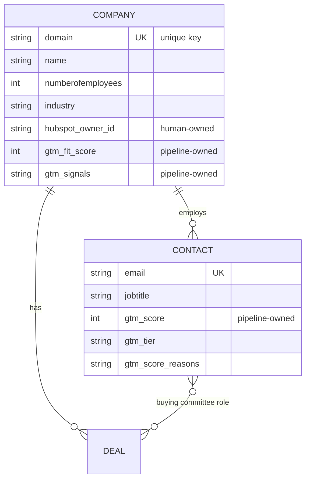

# Step 9: CRM write-back

**Goal:** the clean, enriched, scored, routed result lands in the CRM, the single source of truth,
**without creating duplicates, without wiping good data and without stealing owners**, and running it
again changes nothing that didn't change.

Deep dive on HubSpot's API: [07-crm-hubspot/02-hubspot-api.md](../07-crm-hubspot/02-hubspot-api.md).

## 8.1 Tools

| Tool | Way | Notes |
| --- | --- | --- |
| **HubSpot API** (`/crm/v3/objects/*/batch/upsert`, v4 associations) | Code | Service key (Bearer). Up to 100 per batch. Upsert by a unique property |
| **Salesforce API** (sObject Collections, Composite, Bulk API 2.0, upsert by External ID) | Code | `PATCH /services/data/vXX.X/sobjects/Account/Domain__c/peopleco.de` upserts by external ID |
| **Pipedrive, Attio, Close** APIs | Code | Same pattern: search by key → update or create |
| **HubSpot import (CSV)** | Click | Choose "create and update", dedupe by email (contacts) / domain (companies) |
| **Clay "Send to HubSpot / Salesforce"** | Click | Map columns → properties, choose update-or-create key |
| **n8n / Zapier / Make** HubSpot nodes | Click + light code | Fine for low volume glue |
| **Reverse ETL: Hightouch, Census** | Click (config) + SQL | Sync warehouse tables to CRM fields with upsert + field-level control |

## 8.2 The data model you write into



## 8.3 The process

1. **Create custom properties once** (`gtm_score`, `gtm_tier`, `gtm_score_reasons`, `gtm_segment`,
   `gtm_signals`, `gtm_last_scored_at`) with the properties API. Prefix them so everyone knows the
   pipeline owns them.
2. **Decide field ownership**: which fields the pipeline may write, which only humans write
   (owner, lifecycle stage set by sales, notes), which are fill-if-empty (industry, employees).
3. **Build payloads**: only owned fields, **never blank values** (a blank would wipe good data).
4. **Diff** against what's in the CRM; skip records with no change (fewer calls, cleaner history).
5. **Dry run**: print/save what would be sent; review on the first runs.
6. **Batch upsert** companies first, then contacts, in batches of ≤ 100, via the retry function.
7. **Associate** contacts to companies (v4 associations).
8. **Handle partial failures**: log failed records with reasons, retry only those.
9. **Log created vs updated**; alert if "created" spikes on a re-run (it means a key is broken).

## 8.4 The code

### Create a unique property once

```python
session.post("https://api.hubapi.com/crm/v3/properties/companies", json={
    "name": "gtm_domain_key", "label": "GTM domain key", "type": "string", "fieldType": "text",
    "groupName": "companyinformation", "hasUniqueValue": True}, timeout=30)
```

### Payloads with field ownership

```python
PIPELINE_OWNED = {"gtm_fit_score", "gtm_score", "gtm_tier", "gtm_score_reasons", "gtm_segment", "gtm_signals"}
FILL_IF_EMPTY  = {"industry", "numberofemployees", "country"}
NEVER          = {"hubspot_owner_id", "lifecyclestage", "notes"}

def company_payload(account, existing):            # existing = current CRM properties or {}
    props = {}
    for k, v in account.items():
        if v in (None, "") or k in NEVER:
            continue
        if k in PIPELINE_OWNED or (k in FILL_IF_EMPTY and not existing.get(k)):
            props[k] = str(v)                        # HubSpot accepts strings for numbers
    if not existing.get("hubspot_owner_id") and account.get("owner"):
        props["hubspot_owner_id"] = account["owner"]  # set owner only on unowned records
    return {"idProperty": "gtm_domain_key", "id": account["domain"], "properties": props}
```

### Batch upsert with retry

```python
def upsert(object_type, inputs):
    totals = {"created": 0, "updated": 0, "errors": 0}
    for batch in chunks(inputs, 100):
        resp = call_with_retry(lambda: session.post(
            f"https://api.hubapi.com/crm/v3/objects/{object_type}/batch/upsert",
            json={"inputs": batch}, timeout=60))
        body = resp.json()
        for r in body.get("results", []):
            totals["created" if r.get("new") else "updated"] += 1
        for e in body.get("errors", []):           # partial failures
            totals["errors"] += 1
            log.error("upsert failed: %s %s", e.get("message"), e.get("context"))
    return totals
```

(The exact response fields can differ between endpoints and API versions; log the raw body on your
first runs and check the docs.)

### Associate contact → company

```python
session.put(f"https://api.hubapi.com/crm/v4/objects/contacts/{contact_id}"
            f"/associations/default/companies/{company_id}", timeout=30)
```

For many at once use the batch associations endpoint.

### Skip unchanged records (diffing)

```python
import hashlib, json
def fingerprint(props):
    return hashlib.sha256(json.dumps(props, sort_keys=True).encode()).hexdigest()

to_send = [p for p in payloads if state.get(p["id"]) != fingerprint(p["properties"])]
# after a successful upsert: state[p["id"]] = fingerprint(p["properties"])
```

### Salesforce equivalent

```python
# upsert by external ID field Domain__c (marked External ID + Unique in Setup)
sf.patch(f"{instance}/services/data/v62.0/sobjects/Account/Domain__c/{domain}",
         json={"Name": name, "GTM_Score__c": score})
# many at once: PATCH /services/data/v62.0/composite/sobjects/Account/Domain__c  (up to 200 records)
```

### Reverse ETL (warehouse → CRM)

```sql
-- model: gtm_scores (Hightouch/Census sync this to HubSpot companies, upsert on domain)
SELECT domain, fit_score AS gtm_fit_score, tier AS gtm_tier, reasons AS gtm_score_reasons
FROM analytics.account_scores
WHERE scored_at >= current_date - 1;
```

In the demo: `to_payloads()` drops blanks and sends only owned fields; `write_back()` does a dry run,
then batch upserts (batch size 5 so you can see batching): 9 companies + 9 contacts created in 4
calls. `--twice` shows the second run: **0 created, 18 updated**. `FakeCRM` also refuses to overwrite
an existing `hubspot_owner_id`.

## 8.5 Pitfalls

- Blind `create` calls: every run makes duplicates.
- Sending `""` or `null` and wiping a field a rep filled in.
- Overwriting owners and starting a turf war with sales.
- Writing to standard fields people rely on (lifecycle stage) without agreement.
- Search-then-create: the search index lags, so two close runs still duplicate. Use upsert by unique
  property.
- No dry run on the first production run.

## 8.6 Interview lines

> "I write with batch upserts by a unique property, domain for companies and email for contacts, in
> batches of 100 through the retry function. The pipeline only writes fields it owns, never blanks,
> never the owner of an existing record. I diff before sending, log created vs updated, and alert if
> creates spike on a re-run, because that means a key broke."
