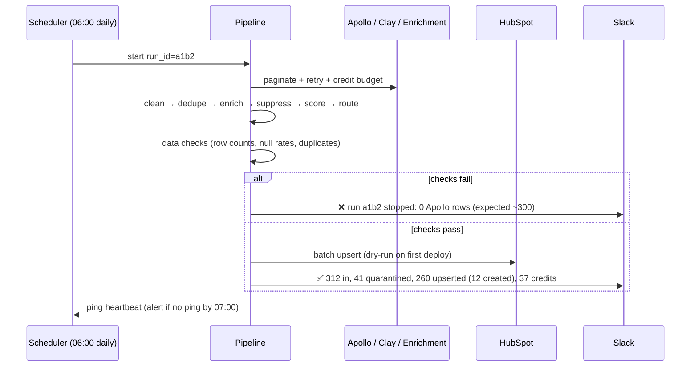

# Step 11: Orchestration, scheduling and monitoring

The steps only become a **system** when they run on their own, in order, recover from failures, tell
someone when something is wrong, and can be re-run safely. More in
[10-production-habits](../10-production-habits).

## 11.0 Start from zero

**Orchestration** = running the steps in the right order, automatically, and knowing what happened.

**A script vs a system:**

| A script | A system |
| --- | --- |
| You run it when you remember | A scheduler runs it every morning |
| If it crashes, you find out days later | Slack tells you within minutes |
| You re-run everything after a crash | Steps are re-runnable; long pulls resume |
| Bad data reaches the CRM | Checks stop the run first |
| Only you understand it | README + runbook + tests |

**Scheduler, from zero:** a program whose only job is "start X at time Y" (cron, GitHub Actions,
Prefect). **Heartbeat, from zero:** your job pings a monitoring URL when it finishes; if no ping
arrives by 07:00, *that* service alerts you. It catches the worst failure of all: the job never ran.

**Data checks, from zero:** small `if` statements between steps that ask "does this look normal?"
(row counts, % quarantined, duplicate keys) and stop the run if not.

## 11.1 Tools

| Tool | What it is | When to pick it | Click or code |
| --- | --- | --- | --- |
| **cron** (Linux) / Task Scheduler (Windows) | Run a command on a schedule | One machine, simple jobs | Config |
| **GitHub Actions `schedule:`** | Cron in the cloud, free for small jobs, logs + secrets built in | Small team, code already on GitHub | YAML |
| **n8n / Zapier / Make** | Visual workflows with triggers, schedules, retries | Glue, low volume, non-engineers maintain it | Click (+ code nodes) |
| **Clay scheduled tables / auto-run** | Re-run enrichment on a schedule | Clay-centred stacks | Click |
| **HubSpot workflows** | In-CRM automation on property changes | Simple CRM logic | Click |
| **Prefect, Dagster, Airflow** | Orchestrators: dependencies between tasks, retries, backfills, UI | Many pipelines, dependencies, a data team | Code |
| **Cloud schedulers** (Cloud Scheduler + Cloud Run, AWS EventBridge + Lambda) | Serverless scheduled jobs | Already on that cloud | Config + code |
| **Slack webhooks, PagerDuty, Healthchecks.io / Cronitor** | Alerts on failure, "dead man's switch" if a job stops running | Always | Config |
| **Sentry / logs** | Error tracking | Always | Code |

## 11.2 What a production run looks like



## 11.3 The process

1. **One entry point** (`python -m pipeline run --since yesterday`) that runs the steps in order.
2. **Config and secrets** from files/env (`.env` locally, GitHub/Cloud secrets in production).
3. **Structured logs** with `run_id`, step, counts, durations.
4. **Data quality checks between steps**, stopping the run before bad data reaches the CRM.
5. **Retries** at the call level (chapter 02) and **re-runnable steps** at the job level (idempotent).
6. **Run report** to Slack: in / quarantined / created / updated / credits / duration.
7. **Failure alert** with the error and a link to logs; **heartbeat** for "it didn't run at all".
8. **Runbook**: what each alert means and what to do (module 10).
9. **Tests + CI** on every change.

## 11.4 The code

### Entry point with steps, logging and checks

```python
import logging, uuid, time, sys
logging.basicConfig(level=logging.INFO, format="%(asctime)s %(levelname)s run=%(run_id)s %(message)s")

def main():
    run_id = uuid.uuid4().hex[:8]
    log = logging.LoggerAdapter(logging.getLogger("gtm"), {"run_id": run_id})
    t0 = time.time()
    try:
        raw = collect(); log.info("collected %d", len(raw))
        check(len(raw) > 50, f"only {len(raw)} rows collected; source broken?")
        clean, quarantine = clean_and_validate(raw)
        check(len(quarantine) / max(1, len(raw)) < 0.25, "over 25% quarantined; source format changed?")
        contacts, accounts = dedupe(clean)
        enrich(accounts)
        scored = score_all(suppress(contacts))
        result = write_back(scored, dry_run="--dry-run" in sys.argv)
        check(result["created"] < 0.5 * len(scored) or first_run(), "creates spiked; key broken?")
        slack(f"✅ GTM run {run_id}: {len(raw)} in, {len(quarantine)} quarantined, "
              f"{result['created']} created, {result['updated']} updated, {time.time()-t0:.0f}s")
    except Exception as e:
        log.exception("run failed")
        slack(f"❌ GTM run {run_id} failed at {e.__class__.__name__}: {e}")
        raise
    finally:
        ping_heartbeat()

def check(ok, message):
    if not ok:
        raise RuntimeError(f"data check failed: {message}")
```

### Schedule with GitHub Actions

```yaml
name: gtm-daily
on:
  schedule:
    - cron: "30 4 * * 1-5"          # 04:30 UTC = 10:00 IST, weekdays
  workflow_dispatch: {}              # "Run workflow" button for manual runs
concurrency: gtm-daily              # never two runs at once
jobs:
  run:
    runs-on: ubuntu-latest
    timeout-minutes: 30
    steps:
      - uses: actions/checkout@v4
      - uses: actions/setup-python@v5
        with: { python-version: "3.12" }
      - run: pip install -r requirements.txt
      - run: pytest -q
      - run: python -m pipeline run
        env:
          HUBSPOT_TOKEN: ${{ secrets.HUBSPOT_TOKEN }}
          APOLLO_API_KEY: ${{ secrets.APOLLO_API_KEY }}
          SLACK_WEBHOOK_URL: ${{ secrets.SLACK_WEBHOOK_URL }}
```

Example in this repo: [10-production-habits/examples/github_actions_schedule.yml](../10-production-habits/examples/github_actions_schedule.yml).

### The same as a Prefect flow (when you outgrow one script)

```python
from prefect import flow, task

@task(retries=3, retry_delay_seconds=60)
def collect_apollo(): ...

@task
def score(rows): ...

@flow(log_prints=True)
def gtm_daily():
    rows = collect_apollo()
    write_back(score(clean(rows)))
```

### The same in n8n (click path)

Schedule Trigger (daily) → HTTP Request (Apollo, pagination option on) → Code node (clean + score in
JS/Python) → IF (score ≥ 60) → HubSpot node (upsert contact) → Slack node (summary). Error Workflow
→ Slack on failure.

## 11.5 Data quality checks worth having

| Check | Catches |
| --- | --- |
| Row count vs last 7-day average | Broken source, expired key, filter change |
| % quarantined | Source format change |
| Null rate per key field (domain, email) | Mapping bug |
| Duplicate keys after dedupe = 0 | Dedupe bug |
| Created vs updated ratio on re-runs | Broken upsert key |
| Credits used vs budget | Missing cache |
| Score distribution shift (e.g. % tier A) | Rule or data change |

In the demo, `run()` executes all steps in order and ends with four checks (`[PASS] ...`); `--twice`
is the idempotency test, and `pytest` runs [code/test_pipeline_end_to_end.py](code/test_pipeline_end_to_end.py).

## 11.6 Interview lines

> "One entry point, steps in order, data checks between steps that stop the run before bad data hits
> the CRM, a Slack summary every run, an alert on failure, and a heartbeat in case it never starts.
> GitHub Actions on a cron is enough at first; I'd move to Prefect or Dagster once there are several
> dependent pipelines."

## 11.7 Summary

- One entry point, steps in order, **config + secrets outside code**, **structured logs with run_id**.
- **Data checks between steps** stop the run before bad data reaches the CRM.
- **Retries per call, idempotent steps per run**, checkpoints for long pulls.
- **Slack summary every run, alert on failure, heartbeat for "didn't run"**, runbook for each alert.
- GitHub Actions cron to start; Prefect/Dagster/Airflow when pipelines depend on each other.

## 11.8 Key functions to remember

| Function | Input → output |
| --- | --- |
| `main()` | runs every step with logging, checks, Slack, heartbeat |
| `check(ok, message)` | stops the run with a clear reason |
| `run()` (demo) | all steps + checks + output files → `(report, crm, cache)` |
| `slack(text)` | posts a summary/alert |
| `ping_heartbeat()` | tells the monitor "I ran" |

## 11.9 Important logic

| Check | Fail when (example) |
| --- | --- |
| Rows collected | < 50% of the 7-day average |
| Quarantine rate | > 25% |
| Enrichment failure rate | > 10% (pattern 6 alert) |
| Duplicate keys after dedupe | > 0 |
| Creates on a re-run | > 50% of records |
| Credits used | > budget |

## 11.10 Check yourself

1. What does a heartbeat catch that a failure alert can't?
2. Why `concurrency:` in the GitHub Actions workflow?
3. Where should the "quarantine rate > 25%" check sit, and why there?

<details><summary>Answers</summary>

1. A job that never started (scheduler off, workflow disabled), so no failure was ever raised.
2. So two runs never overlap and write to the CRM at the same time.
3. Right after cleaning/validation, before dedupe/enrichment/write-back, so a broken source stops the run before it costs credits or touches the CRM.
</details>
