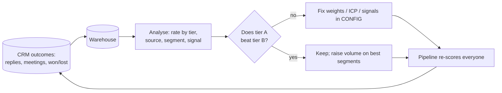

# Step 12: Reporting and the feedback loop

The pipeline isn't finished when data reaches the CRM. You need to know **whether it works** (do
A-tier leads book more meetings? which source produces pipeline?) and feed that back into the ICP,
the scores and the sequences.

## 12.1 Tools

| Tool | Role | Click or code |
| --- | --- | --- |
| **HubSpot / Salesforce reports + dashboards** | Funnel, owner activity, sequence performance | Click |
| **Sequence tool analytics** (Apollo, Outreach, lemlist...) | Reply / bounce / meeting per step | Click |
| **Warehouse**: BigQuery, Snowflake, Postgres, DuckDB (local) | All data in one place with history | SQL |
| **ELT into the warehouse**: Fivetran, Airbyte, HubSpot native sync, your Python | Copy CRM/tool data in | Click / code |
| **dbt** | Version-controlled, tested SQL models (`stg_` → `int_` → `mart_`) | Code |
| **BI**: Looker Studio, Metabase, Looker, Power BI, Tableau | Dashboards for the Head of GTM | Click |
| **Reverse ETL**: Hightouch, Census | Push warehouse scores/segments back to the CRM | Click + SQL |
| **Python + pandas** | Ad-hoc analysis, calibration, A/B significance | Code |

## 12.2 The metrics

| Level | Metric | Question it answers |
| --- | --- | --- |
| Pipeline health | rows in, % quarantined, duplicates found, fill rate per field, credits per run, run success rate | Is the machine working? |
| Data quality | % accounts with domain + owner + score; bounce rate | Can reps trust the CRM? |
| Outreach | delivered, reply rate, positive reply rate, meetings booked, by sequence/step/segment | Is the message working? |
| Funnel | lead → MQL → SQL → opportunity → won, conversion and time per stage | Where do we lose people? |
| Scoring quality | meeting rate and win rate **by tier** | Does the score predict anything? |
| Source quality | pipeline € and win rate **by source** | Where should we spend credits? |
| Speed | time from inbound to first touch | Are SLAs met? |
| Rep time | manual hours saved, alerts acted on | Is the system used? |

## 12.3 The feedback loop



## 12.4 The code

### Funnel by source (SQL)

```sql
SELECT c.original_source,
       COUNT(*)                                             AS leads,
       COUNT(*) FILTER (WHERE c.replied)                    AS replied,
       COUNT(*) FILTER (WHERE c.meeting_booked)             AS meetings,
       ROUND(100.0 * COUNT(*) FILTER (WHERE c.meeting_booked) / COUNT(*), 1) AS meeting_rate_pct,
       SUM(d.amount_eur) FILTER (WHERE d.stage = 'closed_won') AS won_eur
FROM contacts c
LEFT JOIN deals d ON d.account_id = c.account_id
GROUP BY 1
ORDER BY won_eur DESC NULLS LAST;
```

### Does the score work? (pandas)

```python
import pandas as pd
df = pd.read_csv("out/contacts_with_outcomes.csv")
by_tier = df.groupby("gtm_tier").agg(leads=("email", "count"),
                                     meeting_rate=("meeting_booked", "mean"),
                                     win_rate=("won", "mean")).round(3)
print(by_tier)          # healthy: A > B > C > D on meeting_rate. If not, the weights are wrong.
```

### Is version B of the email really better? (two-proportion test)

```python
from statsmodels.stats.proportion import proportions_ztest
replies, sends = [8, 14], [200, 200]       # A, B
z, p = proportions_ztest(replies, sends)
print(f"p = {p:.3f}")                      # p < 0.05 -> probably real; otherwise keep testing
```

### Pipeline run history (from the run reports)

```python
import json, glob
runs = [json.load(open(f)) for f in sorted(glob.glob("reports/run_*.json"))]
pd.DataFrame(runs)[["run_at", "collected", "quarantined", "crm_created", "credits_used"]].tail(14)
```

### A dbt model (warehouse)

```sql
-- models/marts/mart_account_scores.sql
with accounts as (select * from {{ ref('int_accounts_deduped') }}),
signals  as (select domain, max(case when type like 'funding%' then 1 else 0 end) as had_funding
             from {{ ref('stg_signals') }} where occurred_at >= current_date - 90 group by 1)
select a.domain, a.company, a.country, a.employees,
       (case when a.country in ('DE','AT','CH') then 20 else 0 end
      + case when a.employees between 20 and 500 then 15 else 0 end
      + coalesce(s.had_funding, 0) * 20) as fit_plus_intent
from accounts a left join signals s using (domain)
```

with tests in `schema.yml`: `unique` and `not_null` on `domain`.

In the demo, every run writes `code/output/run_report.json` (counts per step, tiers, suppression
reasons, CRM created/updated, credits, checks), `scored_contacts.csv`, `quarantine.json` and
`outreach_drafts.json`. A related project shows funnel, cohort and A/B analysis in depth:
[KnowBaseWiki Funnel and Conversion Analytics](https://github.com/DhivyaBalakumar/KnowBaseWiki-Funnel-and-Conversion-Analytics-).

## 12.5 Interview lines

> "I report two things: is the machine healthy (rows, quarantine rate, duplicates, credits, run
> success) and is it working (meeting and win rate by tier, source and segment). If tier A doesn't
> beat tier B on meeting rate, the weights are wrong, so the score gets recalibrated, not defended."
