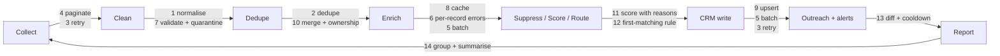

# Chapter 15: The 6 core patterns, and 8 more, inside the pipeline

[HOW_TO_LEARN_THE_CODE.md](../HOW_TO_LEARN_THE_CODE.md) teaches 6 core patterns to rebuild from
memory. This chapter shows **every place each pattern appears in the pipeline**, how its details
change from step to step, the bugs people make, and the "now change it" requests interviewers give.
Then it adds **8 extended patterns** that the rest of the pipeline is made of.

If you can rebuild these 14, you can rebuild the whole pipeline.



| # | Pattern | Steps where it runs | Demo function(s) |
| --- | --- | --- | --- |
| 1 | Normalise | clean, dedupe, CRM match, suppression | `normalise_domain`, `normalise_country`, `parse_employees`, `classify_title`, `name_key` |
| 2 | Dedupe (keep the best) | dedupe contacts, accounts, CRM duplicates, webhook events | `dedupe`, `survivorship` |
| 3 | Retry with backoff | every API call | `call_with_retry` |
| 4 | Pagination | collect from Apollo, CRM, any list API | `fetch_all_pages_page_number`, `fetch_all_pages_cursor` |
| 5 | Batching | enrichment (10), CRM writes (100), verification | `batches`, `write_back` |
| 6 | Per-record error handling | mapping, enrichment, CRM partial failures | `process_all` |
| 7 | Validate + quarantine | cleaning | `clean_and_validate` |
| 8 | Cache / memoise | enrichment, AI classification, title lookups | `enrich_one` (cache dict) |
| 9 | Upsert (idempotent write) | CRM write-back | `FakeCRM.batch_upsert`, `to_payloads` |
| 10 | Merge with field ownership | survivorship, CRM writes | `survivorship`, `FakeCRM.batch_upsert` |
| 11 | Score with reasons from config | scoring, tiers | `score_contact`, `tier_for` |
| 12 | First matching rule wins | suppression, routing, segmentation, reply handling | `suppress`, `route`, `segment` |
| 13 | Snapshot diff + cooldown | signals, alerts | chapter 10 |
| 14 | Group + summarise | reports, checks, analysis | `run()` report, chapter 17 |

---

## Pattern 1: Normalise

**From zero:** a function that takes a messy value and returns the one standard way of writing it (or
`None` if it can't be trusted). Same shape every time:

```python
def normalise_x(value):
    # 1. blank? -> None
    # 2. strip + lowercase (or uppercase for codes)
    # 3. remove/replace the known noise (prefixes, suffixes, aliases)
    # 4. validate the result; return it or None
```

**Where it runs and how the details change:**

| Field | Noise removed | Result | Demo |
| --- | --- | --- | --- |
| Domain | `https://`, `www.`, path, `?query`, the `name@` of an email | `peopleco.de` | `normalise_domain` |
| Email | spaces, uppercase | `anna@peopleco.de` | inside `clean_and_validate` |
| Country | names, languages, lowercase | `DE` | `normalise_country` |
| Employees | commas, ranges, junk | `125` | `parse_employees` |
| Industry | provider vocabularies | `software` | `INDUSTRY_ALIASES` |
| Company match key | case, punctuation, legal suffixes | `peopleco` | `name_key` |
| Title | free text → two categories | `("vp_head", "it")` | `classify_title` |
| Person name | `Dr.`, `Prof.` | `Eva` | `clean_person_name` |

**Reference (pipeline version):**

```python
def normalise_domain(value):
    if blank(value):
        return None
    v = value.strip().lower()
    if "@" in v:
        v = v.split("@")[-1]
    v = re.sub(r"^https?://", "", v)
    v = re.sub(r"^www\.", "", v)
    return v.split("/")[0].split("?")[0] or None
```

**Bugs people make:** normalising the display value (reps see "peopleco"); `.replace("www.", "")`
(also breaks `awww.design`); forgetting emails; returning `""` in one place and `None` in another.

**"Now change it" requests:**

| Request | Change |
| --- | --- |
| "Also strip a port: `peopleco.de:8080`" | `v = v.split(":")[0]` after cutting the path |
| "Personal domains should return None" | `return None if v in PERSONAL else v` |
| "Handle `peopleco.de.` (trailing dot)" | `v.rstrip(".")` |
| "Treat `peopleco.com` and `peopleco.de` as one company" | An alias table `{"peopleco.com": "peopleco.de"}` applied at the end |

---

## Pattern 2: Dedupe, keeping the best

**From zero:** group records by a key, and from each group keep one best record (or merge them).

```python
best = {}
for row in rows:
    key = make_key(row)                # normalised email / domain
    if not key:
        continue
    if key not in best or better(row, best[key]):
        best[key] = row
return list(best.values())
```

**Where it runs:**

| Place | Key | "Better" means |
| --- | --- | --- |
| Contacts | lowercase email | higher-priority source, then more complete (survivorship) |
| Accounts | normalised domain | same, plus CRM values first |
| Fuzzy accounts | name match key + country | similarity ≥ 0.90 |
| CRM duplicates | domain in CRM | report, don't auto-merge |
| Webhook events | event id | first one wins; later retries ignored |
| Alerts | (account, signal type) within cooldown | first alert wins |

**The pipeline's upgrade: merge instead of discard** (`survivorship`): for each field take the first
non-blank value from the best source, and record lineage.

**pandas:** `df.sort_values(["source_rank", "filled"], ascending=[True, False]).drop_duplicates("email")`
(discards); `df.groupby("email").agg({...})` (merges with per-field rules).

**Bugs:** deduping before normalising; keeping "first seen" (random) instead of "best"; deduping the new
batch but not against the CRM; fuzzy-merging across countries.

| Request | Change |
| --- | --- |
| "Keep the most recent instead" | `better = row["updated_at"] > best[key]["updated_at"]` |
| "Merge the losers' fields in" | Use `survivorship(group, fields)` per group |
| "Show me what was merged" | Keep `sources` and `lineage` on the golden record |

---

## Pattern 3: Retry with exponential backoff

**From zero:** try; if it failed for a temporary reason, wait a bit longer each time and try again; give
up clearly after N tries.

**Reference (pipeline version):**

```python
def call_with_retry(fn, *, max_attempts=5, base_delay=0.5, sleep=time.sleep, stats=None):
    for attempt in range(1, max_attempts + 1):
        try:
            return fn()
        except RateLimited as e:                    # in real code: 429 / 5xx / timeout
            if attempt == max_attempts:
                raise
            delay = e.retry_after or base_delay * (2 ** (attempt - 1))
            delay += random.uniform(0, delay * 0.1)  # jitter
            if stats is not None:
                stats["retries"] += 1
            sleep(delay)
```

Two design choices worth explaining:
- **`fn` is a zero-argument function** (`lambda: api.search(page, per_page)`), so one retry helper
  wraps any call: Apollo search, HubSpot upsert, Claude, Slack.
- **`sleep` is a parameter**, so tests pass `sleep=lambda s: None` and run instantly.

**Where it runs:** Apollo pages, CRM pages, enrichment calls, batch upserts, Claude calls, Slack posts.
Only the **retryable set** changes per API (e.g. some APIs use 409 for "try again").

**Bugs:** retrying 400/401 forever; no max attempts; no jitter; retrying non-idempotent creates;
`time.sleep` inside library code that makes tests slow.

| Request | Change |
| --- | --- |
| "Cap the wait at 30 s" | `delay = min(30, delay)` |
| "Treat 404 as no data" | catch it and `return None` before the retry logic |
| "Log each retry" | `log.warning("retry %d after %.1fs", attempt, delay)` |
| "Use a library" | `tenacity`: `@retry(wait=wait_exponential_jitter(), stop=stop_after_attempt(5), retry=retry_if_exception_type(RateLimited))` |

---

## Pattern 4: Pagination

**From zero:** loop: ask for a page, keep its records, find the "next" marker, stop when there is none.

**Two versions in the pipeline:**

```python
def fetch_all_pages_page_number(api, per_page, stats):      # Apollo style
    page = 1
    while True:
        body = call_with_retry(lambda: api.search(page, per_page), sleep=lambda s: None, stats=stats)
        yield from body["people"]
        if page >= body["pagination"]["total_pages"]:
            break
        page += 1

def fetch_all_pages_cursor(api, stats):                      # HubSpot style
    after = None
    while True:
        body = api.list(after)
        yield from body["results"]
        after = body.get("paging", {}).get("next", {}).get("after")
        if not after:
            break
```

Notice patterns combining: **pagination calls retry** for each page.

**Bugs:** only reading page 1; `while page < total_pages` (off by one, misses the last page); building
the cursor yourself; no safety stop (an API bug returns the same cursor forever).

| Request | Change |
| --- | --- |
| "Stop when a page is empty" | `if not body["people"]: break` |
| "Follow a `next` URL" | `url = body.get("next"); if not url: break` |
| "Stop after N records for a test" | `itertools.islice(fetch_all(...), N)` |
| "Protect against an infinite loop" | `if after in seen: raise RuntimeError("cursor repeated")` |
| "Resume after a crash" | save `page`/`after` to a state file after each page (chapter 02) |

---

## Pattern 5: Batching

**From zero:** cut a long list into slices of the maximum size an API accepts and send each slice.

```python
def batches(items, size):
    for i in range(0, len(items), size):
        yield items[i:i + size]
```

**Where it runs and the size each time:**

| Call | Max size |
| --- | --- |
| HubSpot batch create/update/upsert/read | 100 |
| Apollo bulk people / organisation enrichment | 10 |
| Salesforce sObject Collections | 200 |
| Clay webhook | 1 row per POST (throttle instead) |
| Demo `write_back` | 5 (`CONFIG["crm_batch_size"]`, small so you see batching) |

**Pipeline version:** `write_back` loops `for batch in batches(payload, size)` and wraps each send in
`call_with_retry`, adding up created/updated.

**Bugs:** `range(0, len(items) - size, size)` (drops the last partial batch); one bad record failing
the whole batch with no per-record handling; batch size in code instead of config.

| Request | Change |
| --- | --- |
| "Strip blanks before sending" | done in `to_payloads` |
| "If a batch fails, continue and report" | wrap each batch in try/except (pattern 6) |
| "Show the progress" | `log.info("batch %d/%d", n, total)` |

---

## Pattern 6: Per-record error handling

**From zero:** loop over records; wrap each one in `try/except`; collect successes and failures (with
the record's key and the error); summarise; alert if too many failed.

**Pipeline version:**

```python
def process_all(records, process, label, max_fail_rate=0.10):
    ok, failed = [], []
    for key, rec in records:
        try:
            ok.append(process(key, rec))
        except Exception as e:
            failed.append({"key": key, "error": f"{e.__class__.__name__}: {e}"})
    rate = len(failed) / len(records) if records else 0
    return ok, failed, {"step": label, "ok": len(ok), "failed": len(failed),
                        "fail_rate": round(rate, 3), "alert": rate > max_fail_rate}
```

**Where it runs in the demo:** the mapping step (`process_all(items, map...)`) and enrichment
(`enrich` calls `enrich_one` per account). Provider B returns a malformed response for
`greenleafretail.com`; the run logs it and continues:

```
enrichment failed for greenleafretail.com: ValueError: provider_b: malformed response ... (logged, run continues, retried next run)
per-record summary: {'step': 'enrich', 'ok': 18, 'failed': 1, 'fail_rate': 0.053, 'alert': False}
```

**Also needed at:** CRM batch partial failures (`errors` list in the response), Claude calls (invalid
JSON for one record), webhook processing (one bad event).

**Bugs:** `except: pass` (silent loss); catching around the *whole loop* (one bad row stops all);
no summary; no threshold (100% failing looks like "a few warnings").

| Request | Change |
| --- | --- |
| "Only catch ValueError" | `except ValueError as e:` so real bugs crash loudly |
| "Write failures to a CSV" | `pd.DataFrame(failed).to_csv("out/failed.csv")` |
| "Fail the run above 10%" | `if summary["alert"]: raise RuntimeError(...)` |

---

## Pattern 7: Validate and quarantine

**From zero:** check each record against rules, collect **every** reason it fails, put failures aside
with reasons, pass the rest.

```python
def clean_and_validate(records):
    cleaned, quarantine = [], []
    for r in records:
        c = normalise_all_fields(r)
        problems = []
        if not c["email"] or not EMAIL_RE.match(c["email"]):  problems.append("invalid_email")
        if c["is_personal_email"] and not c["company"]:        problems.append("personal_email_no_company")
        if c["seniority"] == "junior":                         problems.append("not_a_buyer")
        (quarantine if problems else cleaned).append({**c, "reasons": problems} if problems else c)
    return cleaned, quarantine
```

Different from pattern 6: pattern 6 catches **crashes**; pattern 7 catches **valid-looking but
unusable data**.

---

## Pattern 8: Cache (memoise)

**From zero:** before doing an expensive thing, look up whether you already did it; after doing it,
save the answer.

```python
key = (provider.name, domain)
if key in cache:
    hit = cache[key]                     # free
else:
    hit = provider.lookup(domain)        # costs credits
    cache[key] = hit                     # save hits AND misses (None)
```

Production version adds a timestamp and a TTL (chapter 05) and stores the cache on disk/DB. Python's
`functools.lru_cache` does the same in memory for pure functions (`@lru_cache` on `classify_title`).

Also used for: AI classifications per distinct title or domain, email verification results, geocoding.

---

## Pattern 9: Upsert (idempotent write)

**From zero:** write by a unique key so that writing the same thing twice leaves one record.

```python
def batch_upsert(self, object_type, inputs):
    store = self.companies if object_type == "companies" else self.contacts
    created = updated = 0
    for item in inputs:
        if item["id"] in store:
            updated += 1
            store[item["id"]].update(item["properties"])
        else:
            created += 1
            store[item["id"]] = dict(item["properties"])
    return {"created": created, "updated": updated}
```

Real equivalents: HubSpot `batch/upsert` with `idProperty`, Salesforce upsert by External ID, SQL
`INSERT ... ON CONFLICT (email) DO UPDATE`. The test: run twice, second run creates 0.

---

## Pattern 10: Merge with field ownership

**From zero:** when combining two versions of a record, decide per field who wins. Never overwrite
what a human set; never write blanks.

```python
for k, v in incoming.items():
    if v in (None, ""):                          continue    # never blank out
    if k in HUMAN_OWNED and existing.get(k):     continue    # never steal
    if k in FILL_IF_EMPTY and existing.get(k):   continue    # only fill gaps
    existing[k] = v
```

Runs in survivorship (sources ranked) and in `FakeCRM.batch_upsert` (keeps an existing
`hubspot_owner_id`).

---

## Pattern 11: Score with reasons, from config

**From zero:** start at 0; for each rule in config, if it's true add its points and write down why;
cap; map to a tier.

```python
score, reasons = 0, []
for rule in RULES:                                 # data, not code
    if rule["test"](contact, account):
        score += rule["points"]
        reasons.append(rule["reason"](contact, account))
score = min(100, score)
tier = next(t for floor, t in TIERS if score >= floor)
```

The demo writes the rules out longhand in `score_contact` for readability; the table-driven version
above is the same thing and makes "add a rule" a config change.

---

## Pattern 12: First matching rule wins

**From zero:** an ordered list of `(condition, result)`; return the result of the first condition
that's true; always have a final default.

```python
SUPPRESSION_RULES = [
    (lambda c: c["email"] in unsubscribed,   "unsubscribed"),
    (lambda c: c["domain"] in competitors,   "competitor"),
    (lambda c: c["domain"] in customers,     "existing_customer"),
    (lambda c: c["domain"] in open_deals,    "open_deal"),
    (lambda c: c["is_role_email"],           "role_email"),
]
def first_match(rules, record, default=None):
    return next((result for test, result in rules if test(record)), default)
```

Order **is** the logic: put the most important rule first. Used by suppression, routing (existing
owner before territory), segmentation (`fintech` before `software`), reply handling and title
classification (junior before everything).

---

## Pattern 13: Snapshot diff + cooldown

**From zero:** compare today's state with yesterday's to find what's new (set difference); then
remember when you last acted on each thing and stay quiet for N days.

```python
new_titles = set(today[domain]) - set(yesterday.get(domain, []))
key = (domain, "hiring_security")
if key not in last_alert or now - last_alert[key] > COOLDOWN:
    send_alert(...)
    last_alert[key] = now
```

Used for signals (new job posts, new funding), job changes, and to stop alert spam.

---

## Pattern 14: Group and summarise

**From zero:** turn many records into a few numbers per group: count, sum, mean, rate.

```python
from collections import Counter
Counter(c["tier"] for c in scored)                     # Counter({'B': 3, 'D': 3, 'C': 2, 'A': 1})

df.groupby("tier").agg(contacts=("email", "count"), avg_score=("score", "mean"))
```

```sql
SELECT tier, COUNT(*) AS contacts, AVG(score) AS avg_score FROM scored GROUP BY tier;
```

Every run report, every data check and every dashboard is this pattern. Full chapter:
[17-summarizing-data-and-text.md](17-summarizing-data-and-text.md).

---

## How to practise

1. Rebuild patterns 1–6 with the existing drill: `python 15-deep-dives/code/core_patterns_drill.py`.
2. Rebuild the pipeline-specific functions (patterns 1, 2, 6–14 in pipeline form) with this module's
   drill: `python 16-end-to-end-pipeline/code/pipeline_drill.py`.
3. For each pattern, do one "now change it" request from memory.
4. Explain in one breath how the patterns combine: *paginate (with retry) → normalise → validate →
   dedupe/merge → cache-enrich (per-record errors) → first-match suppress/route → score with reasons →
   batch upsert (with retry) → diff + cooldown alerts → group and summarise.*
