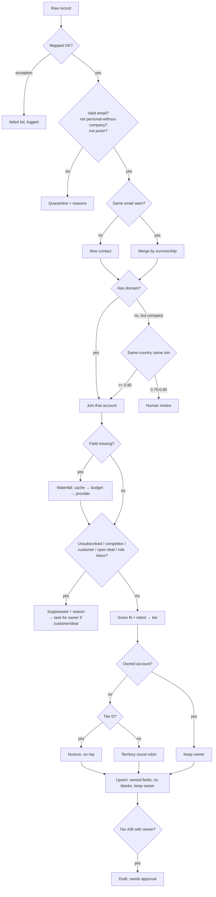

# Chapter 16: Important functions, important logic, important code

A reference for [code/pipeline_end_to_end.py](code/pipeline_end_to_end.py). Three parts:

- **Part A: every important function**: what it takes, what it returns, the logic step by step, the
  edge cases it handles, and a one-line test you could write.
- **Part B: the important logic**: every decision the pipeline makes, as one flow and one table.
- **Part C: the important code idioms**: the 20 Python constructs the file is built from, each
  explained from zero.

Open the script next to this page. Each function name is searchable in it.

---

## Part A: Every important function

### Step 1: Collect

#### `call_with_retry(fn, *, max_attempts=5, base_delay=0.5, sleep=time.sleep, stats=None)`

| | |
| --- | --- |
| **Takes** | `fn`: a function with no arguments that makes one call. Options for attempts, delay, a `sleep` function (tests pass a no-op), a `stats` counter |
| **Returns** | Whatever `fn()` returns; re-raises after the last attempt |
| **Pattern** | 3 (retry) |

Logic: (1) loop attempts 1..max; (2) try `fn()` and return its result; (3) on `RateLimited`: if this was
the last attempt, raise; (4) delay = server's `retry_after`, else `base_delay × 2^(attempt−1)`; (5) add
up to 10% jitter; (6) count the retry; (7) sleep and loop.

Edge cases: server-provided wait wins; non-retryable errors are not caught (they propagate at once).

Test: `call_with_retry(always_429, max_attempts=3, sleep=lambda s: None)` raises after exactly 3 calls.

#### `fetch_all_pages_page_number(api, per_page, stats)` and `fetch_all_pages_cursor(api, stats)`

| | |
| --- | --- |
| **Takes** | A client with `.search(page, per_page)` / `.list(after)` |
| **Returns** | A **generator** of records across all pages |
| **Pattern** | 4 (pagination), page number wraps each call in pattern 3 |

Logic (page number): page=1 → call with retry → `yield from` records → stop if `page >= total_pages`
→ page += 1. Logic (cursor): after=None → call → yield → read `paging.next.after` with `.get` chains →
stop when missing.

Test: with 9 rows and `per_page=3`, the generator yields 9 records over 3 pages.

#### `collect()`

Runs all sources and returns `raw = {"apollo_api", "files", "crm_companies", "crm_deals"}` plus
`stats` (pages, retries). It splits `leads_raw.csv` into "came from the Apollo API" and "came from
files" to imitate both access methods.

### Step 2: Map, clean, validate

#### `map_apollo(p)` / `map_file(r)`

| | |
| --- | --- |
| **Takes** | One record in its source's shape |
| **Returns** | One dict in the **common schema** (`source, company, website, first_name, last_name, email, title, country, city, employees, industry`) |

Logic: read nested fields safely (`p.get("organization") or {}`), split full names with
`str.partition(" ")`, tag `source`. No cleaning here: mapping and cleaning are separate jobs.

#### `blank(v)`

`True` for `None` or a string that's empty after `strip()`. Every "is it missing?" question in the file
goes through this one function, so blank means the same thing everywhere.

#### `normalise_domain(value)` → `"peopleco.de"` or `None`

Logic: blank → None; strip + lower; if `@`, keep after it; regex-remove `^https?://` and `^www\.`; cut at
the first `/` and `?`. Pattern 1.

| In | Out |
| --- | --- |
| `https://www.PeopleCo.de/about` | `peopleco.de` |
| `anna@PeopleCo.de` | `peopleco.de` |
| `www.Brightforge.io` | `brightforge.io` |
| `""`, `None` | `None` |

#### `normalise_country(value)` → ISO-2 or `None`

Logic: blank → None; look up the lowercase value in `COUNTRY_ALIASES`; else if it's 2 letters,
uppercase it; else `None` (never guess).

#### `parse_employees(value)` → int or `None`

Logic: blank → None; remove commas; all digits → int; `lo-hi` range → midpoint; else None.
`"51-200"` → 125, `"abc"` → None.

#### `clean_person_name(value)`

Removes a leading `Dr.`/`Prof.`/`Mr.`/`Mrs.`/`Ms.` (case-insensitive) and capitalises only the first
letter, leaving `McDonald` and `Hans-Peter` intact.

#### `classify_title(title)` → `(seniority, function)`

Logic: two ordered rule lists (pattern 12). Seniority: junior words **first** → C-level words (but not
"product owner") → VP/Head/Director → manager/lead → IC. Function: security → engineering → IT →
executive → finance → sales → other. `\b` word boundaries stop "cto" matching inside "director".

| Title | Result |
| --- | --- |
| `Head of IT` | `("vp_head", "it")` |
| `CISO` | `("c_level", "security")` |
| `Software Engineer Intern` | `("junior", "engineering")` |
| `Chief Technology Officer` | `("c_level", "engineering")` |
| `Product Owner` | `("ic", "other")` (not C-level) |

#### `clean_and_validate(records)` → `(cleaned, quarantine)`

Logic per record: copy it (`dict(r)`, never change the input); normalise every field; derive
`email_domain`, `domain`, `seniority`, `function`, `is_personal_email`, `is_role_email`; **if no website
but a work email, use the email's domain** and mark `domain_from_email`; then collect problems
(`invalid_email`, `personal_email_no_company`, `not_a_buyer`); route to quarantine with `reasons` or to
cleaned. Pattern 1 + 7.

### Step 3: Dedupe

#### `name_key(name)` → match key

Lowercase, replace punctuation (except dots) with spaces, split into words, drop legal suffixes
(`gmbh, ag, bv, b.v., ltd, inc, sa, se, llc`), join. `"PeopleCo GmbH"` → `"peopleco"`.

#### `similarity(a, b)` → 0.0–1.0

`SequenceMatcher(None, name_key(a), name_key(b)).ratio()`. Comparing match keys (not raw names) is what
makes "Nordbank Tech B.V." vs "NORDBANK TECH" a perfect 1.0.

#### `completeness(rec, fields)` → int

How many of `fields` are not blank. Used as the tie-breaker in survivorship.

#### `survivorship(records, fields)` → golden record

Logic: rank records by `(source priority, −completeness)`; for each field, take the first non-blank
value in that order and record its source in `lineage`; else `None` (Python's `for ... else`);
attach `sources`. Patterns 2 + 10.

#### `dedupe(cleaned, crm_companies)` → `(contacts, accounts, review, crm_dupes)`

Logic:
1. **Contacts**: group by email (`defaultdict(list)`), survivorship per group.
2. **CRM index**: `{normalised domain: [crm records]}`; any domain with 2+ records is a CRM duplicate.
3. **Accounts**: group contacts by domain.
4. **Fuzzy** for contacts with a company but no domain: compare only with groups **in the same
   country** (blocking); ≥ 0.90 joins the group; 0.75–0.90 goes to `review`.
5. **Golden account** per domain from its contacts **plus the CRM record** (CRM has top priority),
   with `crm_ids` and `existing_owner`.

### Step 4: Enrich

#### `FakeProvider.lookup(domain)`

Returns the provider's dict for a domain, `None` if unknown, and **raises** for domains in `broken`
(imitating a malformed response) so pattern 6 has something to catch.

#### `process_all(records, process, label, max_fail_rate=0.10)` → `(ok, failed, summary)`

Pattern 6 in full: try each `(key, record)`, collect failures with key + error class + message, compute
the fail rate, set `alert` above the threshold. Reused by mapping and enrichment.

#### `enrich_one(domain, acc, cache, budget_state, stats)`

Logic: work out `missing` fields; for each provider in `WATERFALL`: cache hit → use it; else check the
budget (stop if the next call would exceed it) → call → **cache the answer, even `None`** → charge
only on a hit; copy only **missing** fields, recording lineage; merge `signals` as a sorted set union.
Patterns 8 + 10 + budget.

#### `enrich(accounts, cache, budget)` → `(credits_used, stats, failed, summary)`

Runs `enrich_one` for every account through `process_all`. `budget_state` is a dict so the inner
function can update the running total.

#### `guess_email_patterns(first, last, domain)`

Returns the four common patterns (`first@`, `first.last@`, `flast@`, `f.last@`) for verification.
Never sent to without a verifier saying `valid`.

### Step 5: Suppress

#### `suppress(contacts, accounts, crm_deals, crm_companies)` → `(keep, suppressed)`

Logic: map CRM company id → domain; from deals build `customers` (stage `closed_won`) and `open_deal`
(any stage except won/lost); then first-matching rule per contact (pattern 12): unsubscribed →
competitor → existing_customer → open_deal → role_email. Suppressed records keep a
`suppress_reason`.

### Steps 6–7: Score, segment

#### `score_contact(c, acc)` → `{fit, intent, score, tier, reasons}`

Pattern 11. Fit: target country (+15, +5 DACH), ICP industry (+20), 20–500 staff (+15), buyer
function (+10), senior (+5). Intent: funding (+20), security hiring (+15), inbound source (+15).
`min(100, fit + intent)`, `tier_for(score)`, and a reason string for each rule that fired.

#### `tier_for(score)`

`next(t for floor, t in CONFIG["tiers"] if score >= floor)`: tiers are ordered high to low, so the
first floor the score clears is its tier.

#### `segment(c, acc)` → `{vertical, size_band, persona, segment}`

Size band by employee thresholds, vertical by industry groups, persona by function, joined as
`vertical:size:persona`. `SEQUENCES[vertical]` picks the sequence.

### Step 8: Route

#### `territory_for(country)` → `"DACH"` / `"BENELUX"` / `"REST_EU"` / `None`

#### `route(scored, accounts)`

Pattern 12 with state. Logic per contact (already sorted best first): existing CRM owner → owner
already chosen for this domain in this run → tier D gets no rep → territory round robin
(`itertools.cycle`) → no territory. Records `owner` and `route_reason`. One owner per account.

### Step 9: CRM write-back

#### `to_payloads(scored, accounts)` → `(companies, contacts)`

Builds HubSpot-shaped inputs `{"idProperty": "domain"|"email", "id": key, "properties": {...}}` with
only pipeline-relevant fields and a **dict comprehension that drops blanks**. Companies are
deduplicated with a set of domains.

#### `FakeCRM.batch_upsert(object_type, inputs)` → `{created, updated}`

Asserts ≤ 100 inputs; for each: existing key → update fields **except an already-set
`hubspot_owner_id`**; new key → create. Patterns 9 + 10.

#### `batches(items, size)` / `write_back(crm, companies, contacts, dry_run=False)`

Pattern 5 + 3: slices, then each slice through `call_with_retry`; `dry_run` only counts what would be
sent.

### Step 10–11: Outreach, report

#### `draft_first_touch(c, acc)`

Chooses the hook from the strongest signal (funding → hiring → growth), fills the segment's sequence id,
and marks `DRAFT - needs human approval`.

#### `run(crm=None, cache=None, verbose=True)` → `(report, crm, cache)`

The orchestrator: calls every step in order, prints what happened, runs 4 final checks, writes the
output files. Passing the same `crm` and `cache` into a second call is how `--twice` proves
idempotency.

---

## Part B: The important logic, all in one place



| Decision | Rule | Where |
| --- | --- | --- |
| Retry a call? | Only 429/5xx/network; backoff + jitter; max 5 | `call_with_retry` |
| Next page? | Until `page >= total_pages` / no cursor | `fetch_all_pages_*` |
| Quarantine? | Invalid email, personal email without company, junior | `clean_and_validate` |
| Company domain | Website, else work-email domain | `clean_and_validate` |
| Same contact? | Same normalised email | `dedupe` |
| Same company? | Same domain; else same country + name sim ≥ 0.90; 0.75–0.90 review | `dedupe` |
| Which value survives? | CRM > Apollo > Clay > webinar > website, then completeness | `survivorship` |
| Enrich this field? | Only if blank; cache first; stop at budget | `enrich_one` |
| A provider crashed? | Log, continue, don't cache, retry next run; alert if > 10% fail | `process_all` |
| Suppress? | Unsubscribed → competitor → customer → open deal → role inbox | `suppress` |
| Tier | ≥ 80 A, ≥ 60 B, ≥ 40 C, else D | `tier_for` |
| Owner | Existing → same account → D none → territory round robin | `route` |
| Write a field? | Not blank; not an existing owner | `to_payloads`, `FakeCRM` |
| Draft? | Tier A/B and has an owner | `run` |
| Run healthy? | 4 checks pass | `run` |

---

## Part C: The important code idioms (from zero)

| # | Idiom | Example from the file | What it does |
| --- | --- | --- | --- |
| 1 | `dict.get` with a default | `p.get("organization") or {}` | Read a key that may be missing without crashing |
| 2 | Chained `.get` | `body.get("paging", {}).get("next", {}).get("after")` | Read deep nested JSON safely |
| 3 | f-strings | `f"{lo}-{hi}"`, `f"{c['tier']} {c['score']:>3}"` | Build text; `:>3` right-aligns in 3 characters |
| 4 | List comprehension with filter | `[r for r in leads if r["source"] == "apollo"]` | Build a filtered list in one line |
| 5 | Dict comprehension dropping blanks | `{k: v for k, v in props.items() if not blank(v)}` | Never send blanks to the CRM |
| 6 | Set comprehension | `{c["domain"] for c in scored}` | Unique values |
| 7 | Set operations | `today - yesterday`, `a & b`, `x in s` | New items, overlap, instant membership |
| 8 | `defaultdict(list)` | `by_email[r["email"]].append(r)` | Group without "if key not in dict" |
| 9 | `Counter` | `Counter(c["tier"] for c in scored)` | Count values |
| 10 | `sorted(..., key=lambda r: (a, b))` | `(prio[source], -completeness)` | Sort by several things; `-` for descending |
| 11 | `next(generator, default)` | `next((t for t, cs in ... if country in cs), None)` | First match or a default |
| 12 | `itertools.cycle` | `cycle(["lena", "jonas"])` + `next()` | Round robin |
| 13 | Generators: `yield` / `yield from` | `yield from body["people"]` | Stream records page by page |
| 14 | `lambda` (small inline function) | `lambda: api.search(page, per_page)` | Pass "the call to make" to the retry helper |
| 15 | Unpacking merge `{**a, **b}` | `{**c, **score_contact(c, acc)}` | New dict combining two (right side wins) |
| 16 | `for ... else` | survivorship's field loop | `else` runs only if the loop didn't `break` (no value found) |
| 17 | `try / except / raise` | `process_all`, `call_with_retry` | Handle expected failures; re-raise when out of retries |
| 18 | Custom exception class | `class RateLimited(Exception)` | A named error carrying `retry_after` |
| 19 | `re.sub`, `re.fullmatch`, `re.search` + `\b` | `re.sub(r"^www\.", "", v)` | Pattern-based text cleanup and checks |
| 20 | Dependency injection for tests | `sleep=time.sleep` parameter | Tests pass a fake to run instantly |

### Three snippets worth knowing by heart

```python
# 1. group, then pick the best per group
groups = defaultdict(list)
for r in rows:
    groups[key(r)].append(r)
best = [max(g, key=lambda r: completeness(r, FIELDS)) for g in groups.values()]

# 2. first matching rule
reason = next((label for test, label in RULES if test(record)), None)

# 3. safe nested read + loop until no next page
while True:
    body = call_with_retry(lambda: fetch(after))
    yield from body.get("results", [])
    after = body.get("paging", {}).get("next", {}).get("after")
    if not after:
        break
```
