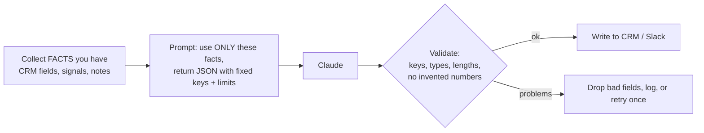

# Chapter 17: Summarizing data and text

A GTM engineer summarizes all day, in two very different ways:

| Kind | Input | Output | Tools | Example |
| --- | --- | --- | --- | --- |
| **Summarizing data** | Many rows | A few numbers per group | `Counter`, pandas `groupby`, SQL `GROUP BY` | "Tier A books meetings at 40%, tier B at 15%" |
| **Summarizing text** | Long words (notes, calls, websites, emails) | A short, structured brief | Claude (or extractive rules) | "Kite Labs needs SOC 2 for two banks by Q1; next step: questionnaire" |

The first must be **exact** (computed, never estimated). The second must be **grounded** (only facts
from the source) and **checked** (validated before it reaches the CRM).

Runnable companion: [code/summarize_demo.py](code/summarize_demo.py) (offline; `--live` uses Claude).

```powershell
python 16-end-to-end-pipeline/code/summarize_demo.py
```

---

## Part 1: Summarizing data

### 17.1 From zero: what "summarize" means for a table

You have 1,000 rows. Nobody reads 1,000 rows. A summary answers a question with a handful of numbers:

| Question | Summary operation | Result shape |
| --- | --- | --- |
| How many? | count | one number |
| How many per tier? | group + count | one row per tier |
| What's the average score per tier? | group + mean | one row per tier |
| What share have an email? | mean of a yes/no column | a percentage |
| Pipeline € per owner per stage? | two-way group + sum (pivot) | a grid |
| Where do leads drop off? | counts per stage, then ratios | a funnel |

**The five aggregate functions:** `count`, `sum`, `mean` (average), `min`/`max`, `median`. Plus
**rates**, which are just `count of yes ÷ count of all`.

**Mean vs median:** mean is pulled by extremes; median is the middle value. Speed-to-lead is a classic
case: one lead left 4 days untouched makes the *mean* look terrible while the *median* shows the
typical experience. Report both, or the median plus the worst cases.

### 17.2 Counting in pure Python: `Counter`

```python
from collections import Counter
tiers = Counter(c["tier"] for c in scored)          # Counter({'B': 3, 'D': 3, 'C': 2, 'A': 1})
tiers["A"]                                          # 1
tiers.most_common(1)                                # [('B', 3)]
Counter(s["suppress_reason"] for s in suppressed)   # {'open_deal': 8, 'existing_customer': 3, ...}
```

Good for run reports and checks: no pandas needed, works on lists of dicts.

### 17.3 Fill rate: how complete is the data?

```python
fill = (df.notna().mean() * 100).round(0)    # % non-blank per column
```

`notna()` gives True/False per cell; the mean of True/False is the share of True. On the demo output
`owner` is 78% filled (the two tier-D contacts have no rep, by design). Track fill rate **before and
after enrichment** to prove enrichment worked (the demo prints employees 17 → 19 of 19).

### 17.4 `groupby` + `agg`: the workhorse

```python
by_tier = scored.groupby("tier").agg(
    contacts=("email", "count"),      # new_column=(source_column, function)
    avg_score=("score", "mean"),
    avg_fit=("fit", "mean"),
    with_owner=("owner", "count"),    # count ignores blanks -> "how many have an owner"
).round(1)
```

Demo output:

```
      contacts  avg_score  avg_fit  with_owner
tier
A            1       90.0     70.0           1
B            3       66.7     56.7           3
C            2       50.0     50.0           2
D            3       26.7     26.7           1
```

How to read the syntax: **split** rows into groups by `tier` → **apply** a function to a column in
each group → **combine** into one row per group. "Split-apply-combine" is the name of the idea.

Other forms you'll see:

```python
df.groupby("source")["meeting_booked"].mean()            # one column, one function
df.groupby(["vertical", "tier"]).size()                  # count rows per combination
df["tier"].value_counts(normalize=True)                  # shares instead of counts
df.groupby("owner")["amount_eur"].sum().sort_values(ascending=False).head(5)   # top 5
```

### 17.5 Two dimensions: `crosstab` and `pivot_table`

```python
pd.crosstab(scored["vertical"], scored["tier"])          # counts in a grid
deals.pivot_table(index="owner", columns="stage", values="amount_eur",
                  aggfunc="sum", fill_value=0)           # sums in a grid
```

Demo output (crosstab):

```
tier      A  B  C  D
vertical
fintech   0  0  1  0
other     0  1  1  3
software  1  2  0  0
```

Reading it: every software lead is A or B, and three of the five "other" leads are D. That's a fact
about the ICP, found in one line.

### 17.6 Funnel and speed-to-lead

```python
inbound["minutes_to_first_touch"] = (inbound["first_contacted_at"] - inbound["created_at"]).dt.total_seconds() / 60
funnel = inbound.groupby("source").agg(leads=("id", "count"),
                                       contacted=("first_contacted_at", "count"),
                                       meetings=("meeting_booked", "sum"),
                                       median_minutes=("minutes_to_first_touch", "median"))
funnel["meeting_rate_%"] = (100 * funnel["meetings"] / funnel["leads"]).round(0)
```

Demo output:

```
           leads  contacted  meetings  median_minutes  meeting_rate_%
source
demo_form      5          4         4            22.0            80.0
webinar        4          4         2          3960.0            50.0
outbound       3          3         1             0.0            33.0
website        4          1         0          5355.0             0.0
```

The story in one sentence: demo-form leads get touched in about 20 minutes and 80% book meetings;
website leads wait days, mostly never get contacted, and none book. That's a routing/SLA fix, and
this table is the evidence.

### 17.7 The same in SQL

```sql
SELECT tier, COUNT(*) AS contacts, ROUND(AVG(score), 1) AS avg_score
FROM scored
GROUP BY tier
ORDER BY tier;

SELECT owner,
       SUM(CASE WHEN stage NOT IN ('closed_won','closed_lost') THEN amount_eur ELSE 0 END) AS open_eur,
       SUM(CASE WHEN stage = 'closed_won' THEN amount_eur ELSE 0 END)                    AS won_eur,
       COUNT(*) AS deals
FROM deals
GROUP BY owner
HAVING COUNT(*) >= 2           -- HAVING filters groups; WHERE filters rows before grouping
ORDER BY open_eur DESC;
```

| pandas | SQL |
| --- | --- |
| `groupby("tier")` | `GROUP BY tier` |
| `.agg(n=("email","count"))` | `COUNT(email) AS n` |
| `df[df.x > 5]` before grouping | `WHERE x > 5` |
| filter after grouping | `HAVING ...` |
| `sum` of a condition | `SUM(CASE WHEN ... THEN 1 ELSE 0 END)` or `COUNT(*) FILTER (WHERE ...)` (Postgres) |
| `pivot_table` | `SUM(CASE WHEN stage='x' ...)` per column |
| rank within a group | `ROW_NUMBER() OVER (PARTITION BY ... ORDER BY ...)` |

More SQL lessons: [05-sql](../05-sql).

### 17.8 Summarizing the pipeline itself (the run summary)

Every run should end with one line a human can read in 5 seconds:

```
GTM run: 25 in, 2 quarantined, 22 contacts at 19 accounts, 13 suppressed, tiers A=1, B=3, C=2, D=3
| CRM +9 new / 0 updated | 21 credits | 1 enrich failures | checks all pass
```

Rules for a good run summary: counts at each stage (so a drop is visible), money (credits), failures,
and a clear pass/fail. Post it to Slack; store the JSON (`run_report.json`) so you can chart it over
time (chapter 12).

### 17.9 Rules for honest data summaries

- **Compute, never estimate.** If a number is in a summary, a line of code produced it.
- **Show the denominator.** "50% win rate (2/4)" is honest; "50%" alone hides a tiny sample.
- **Small samples:** say so, or test significance (chapter 12).
- **Same definition everywhere:** define "meeting rate" once (meetings ÷ leads, not ÷ contacted) and
  reuse it.
- **Median for skewed things** (time, deal size), mean for scores.

---

## Part 2: Summarizing text

### 17.10 From zero: where text summaries help in GTM

| Use | Input | Output | Who reads it |
| --- | --- | --- | --- |
| **Account brief** before a call | CRM fields, signals, notes, website text | 1 line + why now + talking points + risks | AE/BDR |
| **Call summary** | Transcript (Gong/Fathom) or notes | Pain, timeline, stakeholders, next steps → CRM fields | AE, manager |
| **Reply summary + label** | Prospect's email reply | label (interested/not now/...) + one line | Rep, automation |
| **Weekly account digest** | All activity on top accounts | 3 bullets per account | Head of GTM |
| **Deal risk note** | Deal history | What's missing (no economic buyer, no date) | Manager |

### 17.11 The method: facts in, JSON out, validate, then write



Why each piece:
- **Facts in**: the model can't invent what you didn't give it if you forbid it and check.
- **JSON out with fixed keys**: your code can store `next_steps` in a CRM field; prose can't be parsed.
- **Limits** (≤ 25 words, max 3 items): reps read short things.
- **Validate**: models occasionally add fields, exceed limits or invent numbers. Code catches it.

### 17.12 The account brief (from the demo)

```python
prompt = ("ACCOUNT BRIEF. Use ONLY the facts below; if something isn't in the facts, don't say it. "
          "Return JSON with keys one_liner (str, <= 25 words), why_now (list of str, each citing a fact), "
          "talking_points (list, max 3), risks (list, max 3).\n"
          f"FACTS: {json.dumps(ACCOUNT_FACTS)}")
brief = json.loads(model(prompt))
problems = validate(brief, {"one_liner": str, "why_now": list, "talking_points": list, "risks": list})
```

```python
def validate(obj, schema, allowed_extra=()):
    problems = [f"missing {k}" for k in schema if k not in obj]
    problems += [f"{k} should be {t.__name__}" for k, t in schema.items() if k in obj and not isinstance(obj[k], t)]
    problems += [f"unexpected field {k}" for k in obj if k not in schema and k not in allowed_extra]
    return problems
```

In production, use the API's structured-output / tool-use features (a JSON schema the model must
follow) and still validate. The `pydantic` model from chapter 03 is a neat way to declare the schema.

### 17.13 Long text: map-reduce

A 60-minute call transcript can be longer than you want to send at once, and long inputs make models
skip details. Split it:

1. **Map:** summarise each chunk into facts (`{"facts": [...]}`).
2. **Reduce:** combine all chunk facts into the final summary.

```python
facts = []
for chunk in chunks:                                             # MAP
    facts += json.loads(model(f"Extract the key facts as JSON. CHUNK: {chunk}"))["facts"]
combined = json.loads(model(f"COMBINE these facts into JSON with keys summary and next_steps. "
                            f"Do not add numbers that aren't in the facts. FACTS: {facts}"))
```

**Grounding check** (the demo's): every number in the output must appear in the source text.

```python
for k, v in combined.items():
    for token in str(v).split():
        digits = "".join(ch for ch in token if ch.isdigit())
        if digits and digits not in source_text:
            problems.append(f"'{k}' contains a number not in the source: {token}")
```

The demo's fake model deliberately adds `"deal_size_eur": 50000`, which appears nowhere in the call
notes. Validation reports:

```
['unexpected field deal_size_eur', "'deal_size_eur' contains a number not in the source: 50000"]
```

That invented deal size would otherwise have landed in the CRM and in the forecast.

Chunking tips: split on natural boundaries (speaker turns, paragraphs), overlap chunks slightly so a
sentence isn't cut in half, and keep the chunk's position so the summary can cite "minute 12".

### 17.14 No-AI fallback: extractive summary

Sometimes you just need the 2 most important sentences, cheaply and deterministically:

```python
def extractive_summary(sentences, keywords, n=2):
    scored = [(sum(k in s.lower() for k in keywords), i, s) for i, s in enumerate(sentences)]
    top = sorted(sorted(scored, reverse=True)[:n], key=lambda x: x[1])   # best n, original order
    return [s for _, _, s in top]
```

**Extractive** = copies real sentences (can't hallucinate, may read choppy). **Abstractive** = writes
new sentences (reads well, must be checked). Use extractive as a fallback when the model call fails
or for audit trails.

### 17.15 Rules for safe text summaries

| Rule | Why |
| --- | --- |
| Pass only facts you have; forbid outside knowledge | Stops invention |
| Fixed JSON keys + length limits | Parseable, readable |
| Validate keys, types, lengths, numbers, allowed labels | Catches the mistakes models do make |
| Cite: "why_now" items reference a fact | Reps can check it |
| `temperature=0` for extraction | More consistent output |
| Log input + output | Debugging and review |
| Human in the loop for anything customer-facing | Drafts, not sends |
| Don't send unnecessary personal data to the model | Privacy / GDPR minimisation |
| Measure on a labelled sample | Know the accuracy before trusting it at scale |

---

## 17.16 Summary

- **Data summaries** are computed: `Counter` for quick counts, pandas `groupby/agg`, `crosstab`,
  `pivot_table`, SQL `GROUP BY/HAVING/CASE`. Show denominators; use medians for skewed values.
- Every run ends with a **one-line run summary** and a stored JSON report.
- **Text summaries** follow *facts in → JSON out → validate → write*. Long text uses **map-reduce**.
  A **grounding check** stops invented numbers. **Extractive** summaries are the no-AI fallback.

## 17.17 Key functions to remember

| Function | Input → output |
| --- | --- |
| `Counter(iterable)` | values → counts |
| `df.notna().mean()` | table → fill rate per column |
| `df.groupby(col).agg(new=(col, fn))` | rows → one row per group |
| `pd.crosstab(a, b)` / `df.pivot_table(...)` | rows → grid |
| `validate(obj, schema)` (demo) | model JSON → list of problems |
| `account_brief(model)` (demo) | facts → validated brief |
| `map_reduce_summary(model, chunks)` (demo) | long text → facts, summary, problems |
| `extractive_summary(sentences, keywords, n)` (demo) | sentences → top n, in order |

## 17.18 Check yourself

1. Why does `df.groupby("tier")["owner"].count()` give "how many have an owner", not "how many rows"?
2. Mean time to first touch is 31 hours but the median is 22 minutes. What's going on?
3. What's the difference between `WHERE` and `HAVING`?
4. A call summary says "budget €40k" but the transcript never mentions money. Which check catches it?
5. When would you prefer an extractive summary?

<details><summary>Answers</summary>

1. `count` skips blanks; `size()` counts rows.
2. Most leads are fast but a few waited days; the mean is pulled up by those outliers.
3. `WHERE` filters rows before grouping; `HAVING` filters groups after aggregating.
4. The grounding check (numbers must appear in the source), plus rejecting fields not in the schema.
5. When you need guaranteed-faithful text (audit, compliance), when the model call fails, or for very cheap, deterministic summaries.
</details>
