# Module 16: The end-to-end GTM data pipeline, every step

This module walks the whole pipeline from "data is scattered across ten tools" to "the right rep has
a scored, deduplicated, enriched account in the CRM and a draft message ready". For **every step** you
get:

- **What it does and why**, in plain words.
- **Every common tool** for that step, and whether people use it by **clicking (UI / no-code)** or
  through **code (API + Python)**.
- **The process**, as numbered sub-steps.
- **The concepts** you must be able to explain (pagination, backoff, blocking, survivorship,
  waterfalls, idempotency...).
- **The code**, with every line explained, plus where the same idea runs in the working demo.
- **Pitfalls** and **interview lines**.

Everything runs offline. The demo script does all 11 steps on the sample data in [`data/`](../data):

```powershell
python 16-end-to-end-pipeline/code/pipeline_end_to_end.py           # every step, printed
python 16-end-to-end-pipeline/code/pipeline_end_to_end.py --twice   # proves re-runs create nothing new
python 16-end-to-end-pipeline/code/summarize_demo.py                # summarizing data and text
python 16-end-to-end-pipeline/code/pipeline_drill.py                # 14 functions to rebuild, checked
pytest 16-end-to-end-pipeline/code                                  # the checks
```

## How to study this module

1. **New to the words?** Start with [chapter 0: every concept from zero](00-basics-from-zero.md). It
   ends by following one real record (Lena Vogel at Opal Analytics) through every step.
2. **Run the demo**, then read chapters 01–12 in order. Each starts with a *Start from zero* section
   and ends with a **summary, key functions, important logic and check-yourself questions**.
3. **Learn the building blocks:** [chapter 15](15-the-6-core-patterns-in-the-pipeline.md) shows the
   6 core patterns (plus 8 more) at every place they appear in the pipeline;
   [chapter 16](16-important-functions-logic-and-code.md) explains every important function, all the
   decision logic and the 20 Python idioms the code uses.
4. **Summarizing:** [chapter 17](17-summarizing-data-and-text.md) covers numbers (Counter, groupby,
   pivot, SQL) and text (Claude briefs, map-reduce, grounding checks).
5. **Practise without looking:** fill in [code/pipeline_drill.py](code/pipeline_drill.py) until
   14/14 pass; repeat 2–3 days later. Then the interview walkthrough in chapter 14.

## The pipeline on one page

```mermaid
flowchart LR
    subgraph S1[1. Collect]
        A[Apollo / ZoomInfo / Cognism<br/>Sales Navigator / Clay]
        B[Forms, webinars, events,<br/>CSV exports]
        C[Signals: funding, jobs,<br/>news, web visits, product]
        D[(Existing CRM)]
    end
    S1 -->|APIs + pagination + retries| L[(2. Land raw data)]
    L --> M[3. Map + clean + validate]
    M -->|bad rows| Q[[Quarantine]]
    M --> DD[4. Dedupe + entity resolution]
    DD --> E[5. Enrich + verify<br/>waterfall, cache, credits]
    E --> SP[6. Suppress<br/>customers, open deals, unsubscribes]
    SP --> SC[7. Score + segment<br/>fit + intent, tier, persona]
    SC --> R[8. Route<br/>owner, territory, round robin]
    R --> CRM[(9. CRM write-back<br/>batch upsert by unique key)]
    CRM --> O[10. Outreach<br/>sequences, Claude drafts, human approval]
    CRM --> AL[Signals → Slack alerts]
    O -->|replies, bounces, meetings| CRM
    CRM --> W[(12. Warehouse + reporting)]
    W -->|recalibrate ICP + scores| SC
    X[[11. Underneath: scheduler, retries, logs, data checks, alerts, secrets, tests]]
```



## The chapters

| Step | Chapter | Main tools | Click or code? | In the demo |
| --- | --- | --- | --- | --- |
| 1 | [Data sources and collection](01-data-sources-and-collection.md) | Apollo, ZoomInfo, Cognism, Lusha, Sales Navigator, Clay, Crunchbase, PhantomBuster/Apify, Google Maps scrapers, forms, webinars, CRM | Both: exports by click, APIs by code | `collect()` |
| 1 | [Pagination, rate limits, batching](02-pagination-rate-limits-batching.md) | `requests`, any REST API | Code | `fetch_all_pages_*`, `call_with_retry` |
| 2–3 | [Cleaning, normalisation, validation](03-cleaning-normalisation-validation.md) | Python/pandas, Clay formulas, Excel/Sheets, Insycle | Mostly code | `map_*`, `clean_and_validate` |
| 4 | [Deduplication and entity resolution](04-deduplication-entity-resolution.md) | pandas, rapidfuzz, SQL, HubSpot/Salesforce duplicate tools, Dedupely, Insycle | Code for the logic, UI for merges | `dedupe`, `survivorship` |
| 5 | [Enrichment and verification](05-enrichment-and-verification.md) | Clay waterfalls, Apollo, ZoomInfo, Cognism, Lusha, Hunter, Dropcontact, BuiltWith, ZeroBounce, NeverBounce, Claude | Both | `enrich`, `guess_email_patterns` |
| 6 | [Suppression, compliance and routing](06-suppression-compliance-routing.md) | CRM lists, HubSpot workflows, Chili Piper, LeanData, Python | Both | `suppress`, `route` |
| 7 | [Scoring and segmentation](07-scoring-and-segmentation.md) | Python rules, SQL, HubSpot lead scoring, Clay formulas, Claude classification | Both | `score_contact`, `segment` |
| 8 | [CRM write-back](08-crm-write-back.md) | HubSpot API, Salesforce API, Clay/n8n CRM actions, reverse ETL | Code for pipelines | `to_payloads`, `write_back` |
| 9 | [Outreach and sequencing](09-outreach-and-sequencing.md) | Apollo/HubSpot sequences, Outreach, Salesloft, lemlist, Instantly, Smartlead, HeyReach, Claude | Click to run, code to enrol + personalise | `draft_first_touch` |
| 10 | [Signals and alerts](10-signals-and-alerts.md) | Job boards, news APIs, Crunchbase, website visitor ID, product analytics, Slack | Code | intent part of `score_contact` |
| 11 | [Orchestration, scheduling, monitoring](11-orchestration-scheduling-monitoring.md) | cron, GitHub Actions, n8n, Airflow/Prefect/Dagster, Slack alerts | Code | `run()` + checks |
| 12 | [Reporting and the feedback loop](12-reporting-and-feedback-loop.md) | SQL, BigQuery/Snowflake/Postgres, dbt, Looker/Metabase, Hightouch/Census | Code (SQL) | `run_report.json` |
| — | [Tool stack cheat sheet](13-tool-stack-cheatsheet.md) | Every tool on one page | — | — |
| — | [Telling the story in an interview](14-interview-walkthrough.md) | The 2-minute walkthrough + likely questions | — | — |

| Foundations and reference | What's in it | Code |
| --- | --- | --- |
| [0. Every concept from zero](00-basics-from-zero.md) | Records, keys, types, JSON, HTTP, status codes, auth, pagination, rate limits, batching, webhooks, idempotency, normalising, dedupe, enrichment, scoring, CRM, cron; one record's journey with real values | — |
| [15. The 6 core patterns (+8) in the pipeline](15-the-6-core-patterns-in-the-pipeline.md) | Each pattern: recipe, pipeline version, every place it runs, bugs, "now change it" requests | whole demo |
| [16. Important functions, logic and code](16-important-functions-logic-and-code.md) | Every function explained; the full decision flow; 20 Python idioms | `pipeline_end_to_end.py` |
| [17. Summarizing data and text](17-summarizing-data-and-text.md) | Counter, fill rates, groupby, crosstab, pivot, funnel, SQL, run summaries; Claude briefs, map-reduce, grounding checks, extractive fallback | `summarize_demo.py` |
| Practice drill | 14 functions to rebuild from recipes, auto-checked | `pipeline_drill.py`, solutions, checks |

## What the demo run shows (sample data)

| Step | Result |
| --- | --- |
| Collect | 9 Apollo people over 3 pages (2 automatic retries after 429s), 15 CRM companies over 4 cursor pages, 16 file rows |
| Clean | 23 clean, 2 quarantined (personal email + student/freelancer) |
| Dedupe | 23 records → 22 contacts at 19 accounts; flags PeopleCo existing **twice** in the CRM |
| Enrich | employee count 17 → 19 of 19 accounts filled; 21 of 40 credits; 0 credits on re-run (cache); one provider error (`greenleafretail.com`) logged while the run continues (core pattern 6) |
| Suppress | 13 removed: open deals, existing customers, an unsubscribe, a role inbox (`info@`) |
| Score + segment | 1 tier A, 3 tier B, 2 C, 3 D, each with written reasons |
| Route | existing CRM owners kept; new accounts round-robined per territory; tier D to nurture |
| CRM | 9 companies + 9 contacts created in 4 batch calls; second run: 0 created, 18 updated |
| Outreach | 4 drafts for A/B tiers, marked "needs human approval", nothing sent |

## How this module connects to the rest of the repo

- Python, pandas, SQL basics: modules [03](../03-python), [04](../04-pandas), [05](../05-sql).
- APIs, retries, webhooks: [06](../06-apis-and-webhooks). HubSpot specifics: [07](../07-crm-hubspot).
- Data quality theory: [08](../08-data-quality) and the dedupe deep dive [15/03](../15-deep-dives/03-deduplication.md).
- Claude in pipelines: [09](../09-claude-and-ai). Production habits: [10](../10-production-habits).

## Ground rules used throughout

1. **The CRM is the single source of truth.** Everything ends there, written by upsert.
2. **Every business rule lives in config**, not in code (see `CONFIG` in the demo).
3. **Every step is re-runnable** (idempotent): running twice gives the same CRM, costs no extra credits.
4. **Bad data is quarantined, never silently dropped**, so someone can fix the source.
5. **Nothing is sent automatically.** Outreach is drafted; a human approves.
6. **Only process personal data you're allowed to**: legitimate interest documented, unsubscribes
   honoured, data minimised (see chapter 06).

> Vendor limits and prices change. Where a number is given (for example Apollo's 100 per page / 500
> pages, or HubSpot's 100 per batch) it was checked in November 2026; check the vendor's docs before
> you build.
